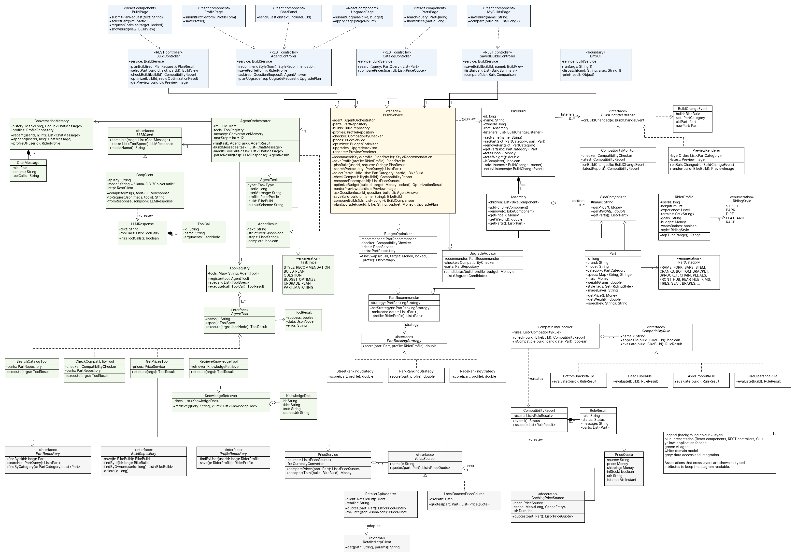
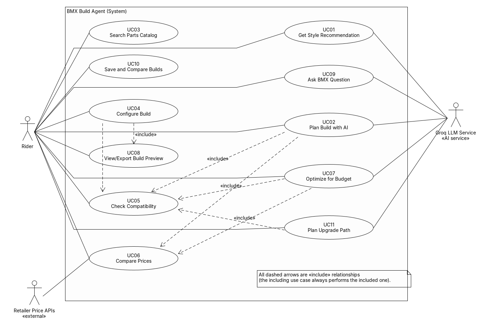
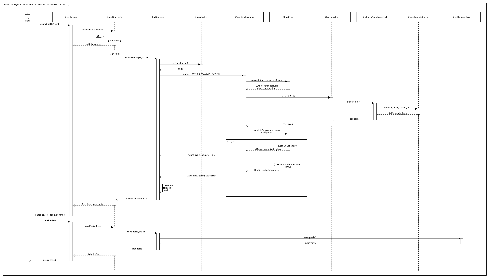
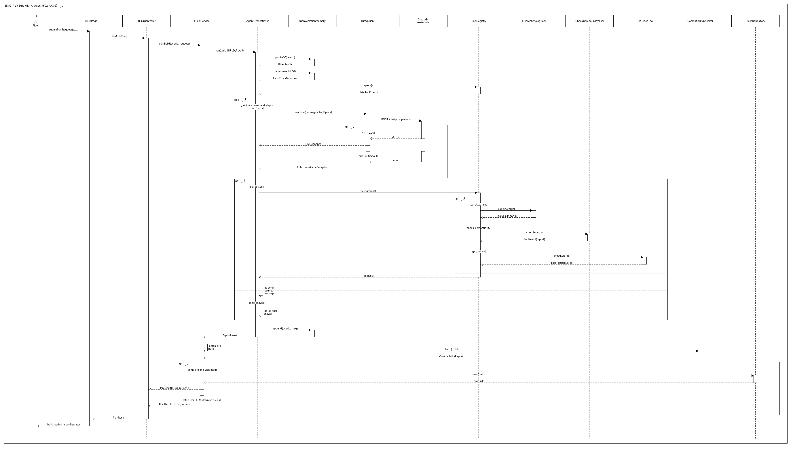
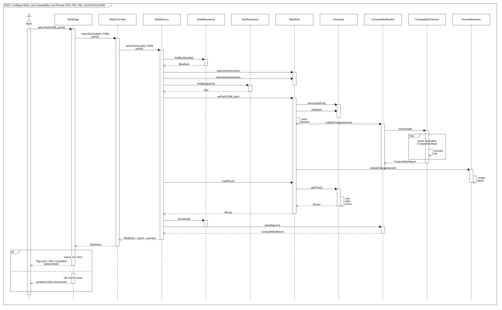
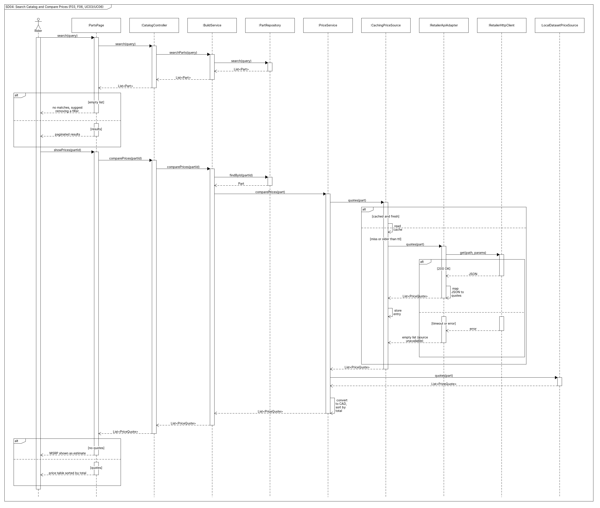
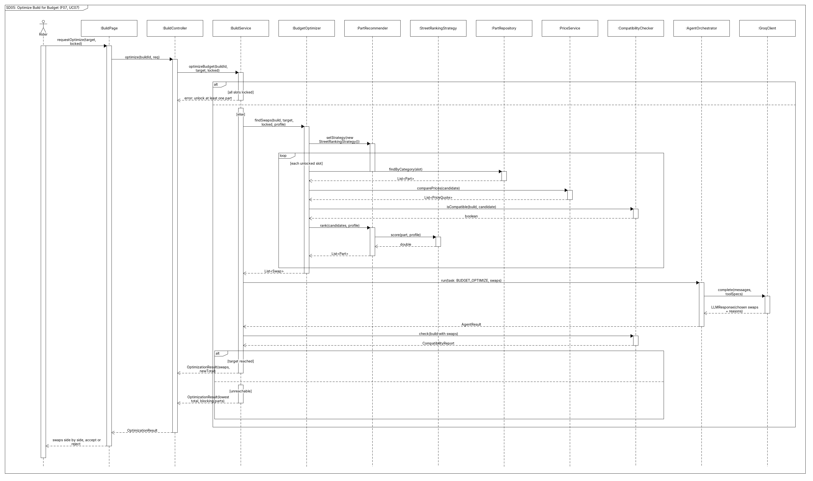
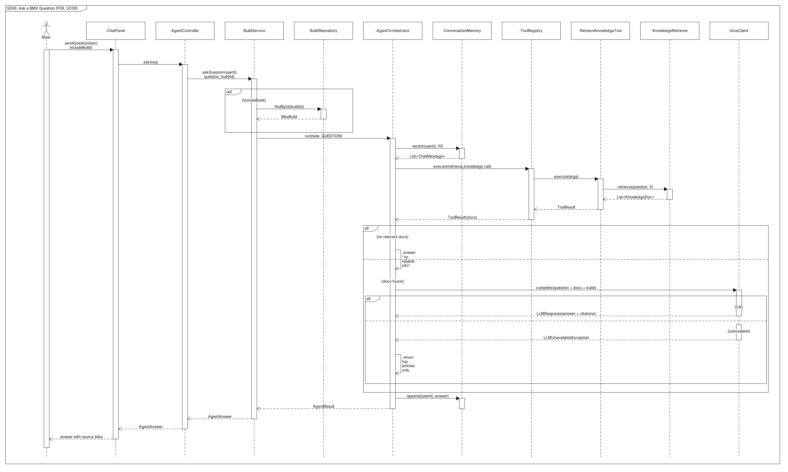
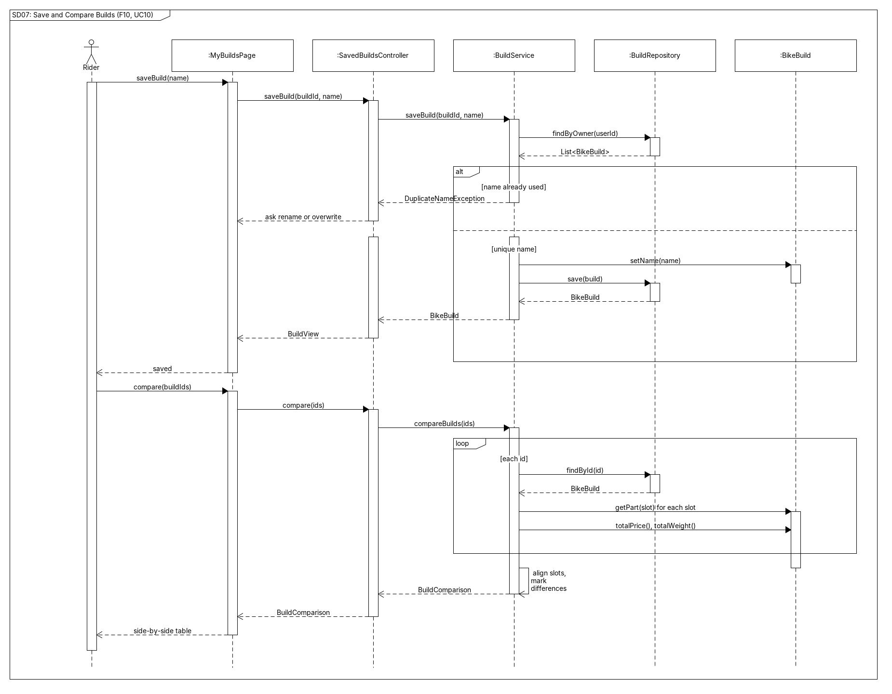
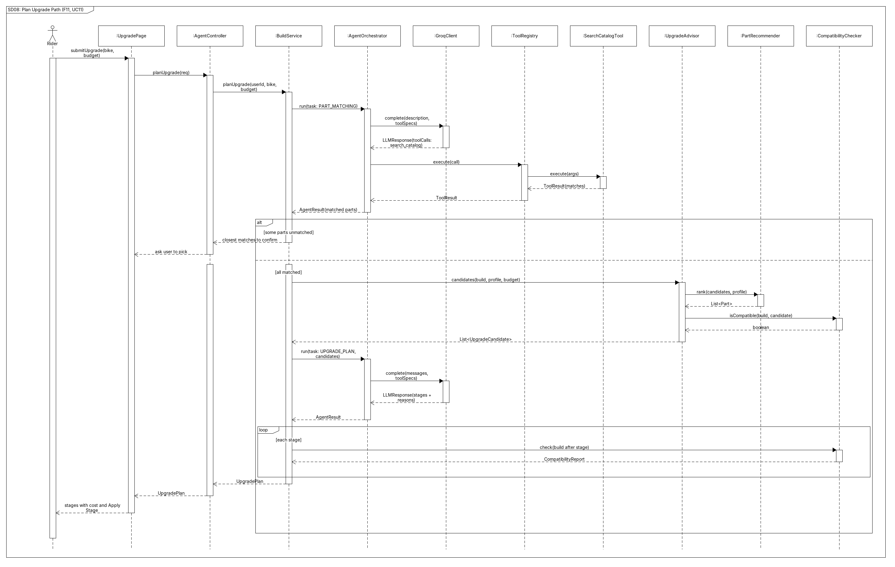

# BMX Build Agent: Stage 1 Design Report

## 1. Agent Project

### 1.1 Project Description

#### Problem

A custom BMX is 15 to 20 parts (frame, fork, bars, stem, cranks, sprocket, hubs, rims, tires, pedals, seat, brakes and more) picked from dozens of brands. The parts have to fit together. The bottom bracket has to match the cranks, the fork has to match the frame's head tube, hub axles have to fit the dropouts, and the tires have to clear the frame. On top of that, prices for the same part change from store to store, and the right parts depend on the rider's height and riding style (street, park, dirt, flatland or race).

Right now all of this is spread across store pages, spec sheets and forums. Beginners often buy parts that don't fit, and once a part is installed it usually can't be returned. Even experienced riders spend a lot of time pricing out a build.

BMX Build Agent is a web app that helps riders plan, check, price and preview a full BMX build. Its AI agent can turn a plain request like "street bike under $900" into a complete build where every part fits.

#### Target Users

- Beginner and intermediate riders building their first custom bike or upgrading a stock one
- Experienced riders pricing out a new build or comparing setups
- Bike shop staff putting together and quoting builds for customers

#### What the Agent Can Do

- Understand a request like *"street bike for a 5'11 rider, brakeless, under $900, I already have pedals"*
- Ask a follow-up question when something important is missing
- Plan a full build by searching the catalog, checking compatibility and looking up prices, then fixing its picks until everything fits the budget
- Recommend a riding style and frame size from the rider's profile
- Answer BMX questions from a knowledge base and show its sources
- Find cheaper parts to hit a budget, and plan upgrades for a bike the rider already owns
- Remember the rider's profile and recent conversation

#### Why an AI Agent

Planning a build is a step-by-step search where every choice affects the next one. The frame decides the bottom bracket type, which limits the cranks, which changes how much budget is left for everything else. Requests are open-ended and different for every rider, so a fixed form can't handle them.

An agent fits this well. The LLM reads the request, picks which tool to use next, looks at the result and adjusts its plan. Anything that has to be correct (compatibility, prices, totals) is done by normal code that the agent calls as a tool. The LLM is never trusted for facts the system can look up, and every build it suggests is checked by the compatibility checker before the user sees it.

#### AI Model

The agent uses an open-weight Llama model hosted on **GroqCloud** (planned: Llama 3.3 70B, `llama-3.3-70b-versatile`). Groq supports tool calling through an OpenAI-style REST API and has a free tier, which suits a student project. The model name is a config setting so it can be swapped.

The rest of the system only talks to the `LLMClient` interface, so moving to another provider later means writing one new class. If Groq is down or rate-limited, each AI feature has a non-AI fallback (described in its error cases).

Knowledge-base search is keyword-based over a local set of BMX articles and part specs.

#### How the AI Fits Into the System

The back end is Java with Spring Boot. The front end is a React app that talks to the back end through a REST API (JSON).

| Layer | What it does |
|---|---|
| Presentation | React pages for the GUI, Spring REST controllers, and a CLI. The controllers and the CLI both call the same service. |
| Application | `BuildService`, one entry point that coordinates the catalog, builds, pricing and the agent |
| Agent | `AgentOrchestrator` (the reasoning and tool loop), `GroqClient`, the tool registry and tools, conversation memory, knowledge-base search |
| Domain | Parts and assemblies, builds, rider profiles, compatibility rules, ranking strategies |
| Data and integration | Part, build and profile repositories (local database), price sources, price caching |

The GUI follows **MVC**. React components are the View, the REST controllers are the Controller, and the domain behind `BuildService` is the Model.

**How the agent works**

1. The orchestrator sends the LLM a system prompt, the user's request, the rider profile and a list of available tools.
2. The LLM answers with either a final answer or a tool call (tool name plus JSON arguments).
3. The orchestrator runs that tool and adds the result to the conversation.
4. Steps 2 and 3 repeat until the LLM gives a final answer or hits the step limit.
5. The final answer (for example a proposed build) is turned into Java objects and checked by normal code before it goes back to the GUI or CLI.

#### GUI and CLI

The GUI covers every feature, F01 to F11. The CLI covers the agent features: style recommendation (F01), build planning (F02), compatibility checks (F05), prices (F06), budget optimizing (F07), Q&A (F09) and upgrade planning (F11).

```
bmx profile                          # F01 profile quiz and style recommendation
bmx plan "street, brakeless, $900"   # F02 agent plans a full build
bmx check <buildId>                  # F05 compatibility report
bmx prices <partId>                  # F06 price comparison
bmx optimize <buildId> --budget 800  # F07 budget optimizer
bmx ask "what's a freecoaster?"      # F09 Q&A
bmx upgrade <buildId> --budget 300   # F11 upgrade plan
```

### 1.2 Feature Specification

#### F01 Rider Profile and Style Recommendation

| | |
|---|---|
| **Description** | The rider fills in a profile and short quiz (height, experience, where they ride, tricks they want to learn, budget, brakes or not). The agent recommends a riding style with reasons and a frame size range. The saved profile is used by the agent in other features. |
| **User interaction** | On the *My Profile* page the user fills in the form and clicks *Get Recommendation*. A card shows the ranked styles, reasons and frame size. *Save Profile* keeps it. |
| **Input** | Height, experience, riding spots, goals, budget, brake preference |
| **Output** | Saved profile, ranked styles with reasons, top tube length range |
| **AI involvement** | Hybrid. Frame size comes from a height table. The style pick comes from the LLM. |
| **Workflow** | 1. User submits the form. 2. Fields are validated. 3. Top tube range is worked out from height. 4. The agent sends the quiz answers and style descriptions from the knowledge base to the LLM. 5. The LLM returns ranked styles as JSON. 6. The result is shown and the user saves the profile. |
| **Errors and alternatives** | Missing or bad fields get inline messages. If the LLM is down or times out, a rule-based score is used and labeled as a basic recommendation. Bad LLM output is retried once, then the rule-based score is used. If two styles are close, both are shown and the user picks. |

#### F02 AI Build Planner

| | |
|---|---|
| **Description** | The user describes the bike they want in plain language. The agent plans a full build that fits by repeatedly searching the catalog, checking compatibility, getting prices and fixing its picks. |
| **User interaction** | On the *Build* page the user types into *Plan My Build*. The panel shows what the agent is doing ("Searching frames", "Checking compatibility"). The finished build opens in the configurator where the user can change it. |
| **Input** | Request text, rider profile (if saved), and things like budget, style, brakes and parts already owned |
| **Output** | A full build with a part in every slot, total price, a short reason per part, trade-offs, and the agent's step log |
| **AI involvement** | AI (agent using normal-code tools) |
| **Workflow** | 1. User submits the request. 2. The orchestrator loads the profile and builds the prompt. 3. The LLM pulls out the constraints and plans the build, or asks a question if something important (like budget) is missing. 4. For each slot the agent searches the catalog, picks a part, checks it fits and gets prices. 5. If something conflicts or goes over budget, the LLM changes its picks. 6. The final build is checked by the compatibility checker and against the budget. 7. The build and reasons are shown. |
| **Errors and alternatives** | Too vague: the agent asks a follow-up. Nothing fits: the agent says which limit is blocking and suggests loosening it. Step limit hit: the best partial build is returned with empty slots flagged. LLM names a part that doesn't exist: the tool returns an error and the agent fixes it. Final check fails: the build isn't shown as complete and the issues are listed. LLM down: an error is shown and the manual configurator (F04) is offered. |

#### F03 Parts Catalog Search and Filter

| | |
|---|---|
| **Description** | Browse and search parts by category, brand, specs (top tube length, bottom bracket type, axle size, weight and so on), price and riding style. |
| **User interaction** | On the *Parts* page the user types in the search bar, picks a category, sets filters and a sort order. Clicking a part opens its details. |
| **Input** | Keyword, category, filters, sort order |
| **Output** | A paged list of parts with key specs and lowest known price, and a detail view |
| **AI involvement** | Deterministic |
| **Workflow** | 1. User enters a search and filters. 2. The part repository is queried, filtered and sorted. 3. Results come back one page at a time. 4. Picking a part shows its full specs. |
| **Errors and alternatives** | No results: a message suggests removing the tightest filter. Min bigger than max: validation message. Database down: error message. |

#### F04 Interactive Build Configurator

| | |
|---|---|
| **Description** | The user builds a bike one slot at a time. Parts are grouped into assemblies (frame and fork, cockpit, drivetrain, wheels, contact points, brakes). Price and weight update live and parts that don't fit are flagged right away. |
| **User interaction** | On the *Build* page, slots are listed by assembly. Clicking a slot opens a part picker for that category. The user can swap or remove parts and the totals update. |
| **Input** | Part picks per slot, optional build name |
| **Output** | Updated build, total price and weight, how complete it is, compatibility status (F05), new preview (F08) |
| **AI involvement** | Deterministic |
| **Workflow** | 1. User picks a slot and a part. 2. The build is updated. 3. The build tells its listeners about the change, so totals update, compatibility is re-checked and the preview is redrawn. |
| **Errors and alternatives** | A part that doesn't fit is allowed but flagged with the reason and an undo option. The picker only shows parts for that slot. Leaving with unsaved changes asks for confirmation. |

#### F05 Compatibility Checker

| | |
|---|---|
| **Description** | A set of rules that checks a build: bottom bracket vs cranks, fork vs head tube, axles vs dropouts, sprocket vs hub driver (gearing), tire width vs frame and fork clearance, brake mounts vs brakes, bar clamp vs stem, and matching wheel sizes. Each rule gives pass, warning or fail with a reason. The agent can use it as a tool. |
| **User interaction** | The compatibility panel on the *Build* page runs on its own and can be re-run with *Check Build*. Each issue highlights the parts involved and offers parts that do fit. |
| **Input** | A build (full or partial) |
| **Output** | A report with each rule's result (status, message, parts) and an overall status |
| **AI involvement** | Deterministic |
| **Workflow** | 1. The checker picks the rules that apply to the parts present. 2. Each rule checks its parts. 3. Rules whose parts aren't picked yet show "not checked yet". 4. Results are put into one report. |
| **Errors and alternatives** | If a part is missing spec data, the rule says "unknown" with a warning instead of passing. On a partial build only the rules that apply are run. |

#### F06 Price Comparison

| | |
|---|---|
| **Description** | Gets current prices for a part from several sources (store APIs where they exist, a local price dataset otherwise), converts them to CAD with shipping and sorts them. It can also total a whole build using the cheapest source for each part. |
| **User interaction** | The user clicks *Compare Prices* on a part or a build slot. A table shows each store's price, shipping, stock, link and when it was last updated. |
| **Input** | Part ID, or a whole build |
| **Output** | Price quotes sorted by total cost, cheapest total for the build |
| **AI involvement** | Deterministic |
| **Workflow** | 1. Every price source is asked for quotes. 2. Prices are converted to CAD. 3. Results are cached for a while. 4. Quotes are sorted and shown. |
| **Errors and alternatives** | A source that fails or times out shows as unavailable and the others still show. No quotes: the catalog MSRP is shown as an estimate. Old cached data shows its timestamp and a *Refresh* button. |

#### F07 Budget Optimizer

| | |
|---|---|
| **Description** | Given a build and a target budget, finds cheaper parts that still fit while protecting the parts that matter most for the rider's style. The agent explains the trade-offs. |
| **User interaction** | On the *Build* page the user clicks *Optimize for Budget*, enters a target and locks parts they want to keep. Suggested swaps show side by side with how much each saves. The user can accept all or some. |
| **Input** | Current build, target budget, locked parts, rider profile |
| **Output** | Suggested swaps (old part, new part, savings, fits or not, reason) and the new total |
| **AI involvement** | Hybrid |
| **Workflow** | 1. For each unlocked slot, cheaper parts that fit are found and ranked for the rider's style. 2. The agent picks a set of swaps that hits the budget while keeping style-critical parts, and explains why. 3. Every swap is checked for compatibility again. 4. The user accepts or rejects swaps. |
| **Errors and alternatives** | Budget can't be reached: shows the lowest possible total and which locked parts are in the way. Everything locked: asks the user to unlock at least one part. Already under budget: says so and offers upgrades (F11). LLM down: shows a cheapest-first result without explanations. |

#### F08 Live 2D Build Preview

| | |
|---|---|
| **Description** | A side-view picture of the build made from layered part images placed on the frame. It updates whenever a part changes. |
| **User interaction** | The preview on the *Build* page updates on its own. The user can switch colours and export it as a PNG. |
| **Input** | Current build (each part's image layer and colour) |
| **Output** | Layered preview image |
| **AI involvement** | Deterministic |
| **Workflow** | 1. A build change triggers a redraw. 2. Layers are put in order (wheels behind the frame, cockpit in front and so on). 3. Each layer is placed using the frame's anchor points and drawn. |
| **Errors and alternatives** | Part with no image: a plain outline for that part type is drawn in its colour. No frame yet: a placeholder frame is shown. Drawing fails: a text summary of the build is shown instead. |

#### F09 BMX Q&A Assistant

| | |
|---|---|
| **Description** | A chat for BMX questions ("what's a freecoaster?", "mid or Spanish bottom bracket?", "what gearing for street?"). The agent finds matching knowledge-base articles and part specs and answers with sources. It can relate the answer to the user's current build. |
| **User interaction** | The *Ask* chat is on every page. Answers show source links, and a toggle adds the current build as context. |
| **Input** | Question, optional current build, chat history |
| **Output** | Answer with sources and links to related parts |
| **AI involvement** | AI (retrieval plus LLM) |
| **Workflow** | 1. User asks a question. 2. Matching knowledge-base articles are found. 3. The question, top passages and (if toggled) a build summary go to the LLM. 4. The LLM may search the catalog for part details. 5. The answer comes back with sources and is saved for follow-up questions. |
| **Errors and alternatives** | No matching articles: the agent says it doesn't have reliable info instead of guessing. Off-topic question: the agent steers back to BMX. LLM down: the top matching articles are shown directly. Unclear follow-up: the agent asks what the user means. |

#### F10 Saved Builds and Side-by-Side Comparison

| | |
|---|---|
| **Description** | Save, name, load, copy and delete builds, and compare two or three side by side by part, price, weight and compatibility, with differences highlighted. |
| **User interaction** | The *My Builds* page lists saved builds. The user selects two or three and clicks *Compare*. |
| **Input** | Build name, selected builds |
| **Output** | Saved builds, comparison table with differences highlighted |
| **AI involvement** | Deterministic |
| **Workflow** | 1. User saves a build with a name. 2. It is stored. 3. On *Compare*, the selected builds are loaded and their slots lined up. 4. The table is shown. |
| **Errors and alternatives** | Name already used: rename or overwrite. A saved build has a discontinued part: the slot is marked unavailable with a suggested replacement. Fewer than two selected: *Compare* is disabled. Save fails: error shown and the build stays open. |

#### F11 Upgrade Path Advisor

| | |
|---|---|
| **Description** | The user describes their current bike (by picking parts or in plain text like "stock complete with plastic pedals and one-piece cranks") and a budget. The agent suggests upgrades in stages, ordered by how much each improves the bike per dollar for their style. Every stage still fits with the parts being kept. |
| **User interaction** | On the *Upgrade My Bike* page the user enters their bike and budget. The result shows each stage's parts, cost and reasons, with an *Apply Stage* button that loads it into the configurator. |
| **Input** | Current bike (parts or description), budget, rider profile |
| **Output** | Upgrade plan with stages, parts, cost per stage and reasons, all checked for compatibility |
| **AI involvement** | Hybrid |
| **Workflow** | 1. If the bike is described in text, the LLM matches it to catalog parts and the user confirms. 2. Upgrade options are scored by normal code. 3. The agent groups upgrades into stages and keeps dependent parts together (three-piece cranks may also need a new bottom bracket). 4. Each stage is checked for compatibility. 5. The plan is shown. |
| **Errors and alternatives** | A described part can't be matched: the user picks from the closest matches. The frame is the limit (for example an old bottom bracket standard): the agent explains and may suggest a new frame as a stage. Budget too low: the single cheapest high-impact upgrade is suggested. LLM down: a ranked list is shown without stages. |

---

## 2. System Design (UML)

### 2.1 Class Diagram

All UML diagrams were made in **UMLet**. The `.uxf` files and PNG exports are in [`docs/diagrams/`](diagrams/).



*Source file [`ClassDiagram.uxf`](diagrams/ClassDiagram.uxf)*

#### How to Read It

The background colour shows the layer.

| Colour | Layer | Main classes |
|---|---|---|
| Blue | Presentation | React components (`BuildPage`, `PartsPage`, `ProfilePage`, `ChatPanel`, `MyBuildsPage`, `UpgradePage`), REST controllers (`BuildController`, `CatalogController`, `AgentController`, `SavedBuildsController`), `BmxCli` |
| Yellow | Application | `BuildService` |
| Green | AI agent | `AgentOrchestrator`, `LLMClient`, `GroqClient`, `ToolRegistry`, `AgentTool` and its four tools, `ConversationMemory`, `KnowledgeRetriever` |
| White | Domain | `BikeBuild`, `BikeComponent`, `Part`, `Assembly`, `RiderProfile`, `CompatibilityChecker`, `CompatibilityRule`, `PartRecommender`, `PartRankingStrategy`, `BudgetOptimizer`, `UpgradeAdvisor` |
| Grey | Data and integration | `PartRepository`, `BuildRepository`, `ProfileRepository`, `PriceService`, `PriceSource` and its classes, `RetailerHttpClient` |

Two things are left out on purpose to keep it readable.

- Simple data classes only used as parameters or return values (`PlanResult`, `BuildView`, `OptimizationResult`, `UpgradePlan`, `AgentAnswer`, `StyleRecommendation`, `Swap`, `UpgradeCandidate`, `PreviewImage`, `Money`, `ToolSpec`) don't get their own boxes.
- Links between classes in different layers (like a tool's link to `CompatibilityChecker`) are shown as typed attributes instead of long lines.

#### Main Design Decisions

- **One entry point.** The REST controllers and the CLI only talk to `BuildService`, so the GUI and CLI always behave the same.
- **The agent only acts through tools.** `AgentOrchestrator` can't touch data directly. It can only run `AgentTool`s from the `ToolRegistry`, and each tool wraps one normal-code service (catalog, compatibility, prices, knowledge base).
- **The LLM provider can be swapped.** `AgentOrchestrator` depends on the `LLMClient` interface, not on Groq.
- **Anything that must be right is normal code.** `CompatibilityChecker`, `PriceService` and the price and weight totals are plain Java and easy to unit test. The LLM suggests, the code checks.

#### Design Patterns

The design uses seven patterns from the course. Each one solves a real problem in this app.

##### Composite

| | |
|---|---|
| **Problem it solves** | A bike is a tree. The build has assemblies (front end, drivetrain, wheels) and assemblies have parts. Price and weight need to be added up across the whole tree, and the code shouldn't care if it's holding one part or a whole assembly. |
| **Classes and roles** | `BikeComponent` (abstract) is the Component, with `getPrice()`, `getWeight()` and `getParts()`. `Part` is the Leaf and returns its own values. `Assembly` is the Composite. It holds a list of `BikeComponent`s and adds them up. `BikeBuild` is the Client and owns the root `Assembly`. |
| **Why it fits** | Totals, weight and "list every part" (used by the checker and the preview) are each one recursive call. Adding a new group like a cockpit assembly doesn't change any totalling code. |
| **Without it** | `BikeBuild` would need hard-coded loops over every slot and group, copied into every place that totals or lists parts. Adding a group would mean editing all of them. |

##### Strategy

| | |
|---|---|
| **Problem it solves** | The "best" part depends on riding style. Street riders want strong parts, race riders want light ones, park is in between. The ranking has to change at runtime based on the rider's profile. |
| **Classes and roles** | `PartRankingStrategy` is the Strategy interface with `score(part, profile)`. `StreetRankingStrategy`, `ParkRankingStrategy` and `RaceRankingStrategy` are Concrete Strategies (dirt and flatland work the same way). `PartRecommender` is the Context. It holds the current strategy and uses it in `rank()`. `BudgetOptimizer` and `UpgradeAdvisor` use the context. |
| **Why it fits** | Each style's rules live in one small class that can be tested on its own, and the optimizer and upgrade advisor share the same ranking. |
| **Without it** | `PartRecommender` would have a big `switch` on riding style that grows with every new style, and changing one style could break another. That breaks Open/Closed. |

##### Observer

| | |
|---|---|
| **Problem it solves** | When a part in the build changes, a few things need to update: compatibility, the preview and the totals. `BikeBuild` shouldn't need to know about the checker or the preview. |
| **Classes and roles** | `BikeBuild` is the Subject. It has `addListener()` and calls `notifyListeners()` from `setPart()` and `removePart()`. `BuildChangeListener` is the Observer interface with `onBuildChanged()`. `CompatibilityMonitor` and `PreviewRenderer` are Concrete Observers. `BuildChangeEvent` carries what changed. |
| **Why it fits** | F04 needs live feedback (F05, F08) on every change. Observer gives that without tying the build to the checker or preview. New reactions like autosave are just another listener. |
| **Without it** | Every place that changes a build (configurator, optimizer, *Apply Stage*, agent planner) would have to remember to call the checker and the preview itself. Forgetting one leaves old results on screen. |

##### Adapter

| | |
|---|---|
| **Problem it solves** | Outside services have their own APIs. Groq expects OpenAI-style JSON and every store returns prices in a different JSON format. The rest of the system should only see one simple Java interface for each. |
| **Classes and roles** | For the LLM, `LLMClient` is the Target and `GroqClient` is the Adapter. It turns `ChatMessage`s and tool specs into Groq's request JSON and turns the reply back into an `LLMResponse`. The Groq API is the Adaptee and `AgentOrchestrator` is the Client. For prices, `PriceSource` is the Target, `RetailerApiAdapter` is the Adapter (it calls `RetailerHttpClient` and maps the JSON with `toQuote()`), the store API is the Adaptee and `PriceService` is the Client. |
| **Why it fits** | Changing LLM providers or adding a store means writing one new adapter. Nothing else changes. |
| **Without it** | Groq and store JSON handling would leak into the agent loop and price logic, and switching providers would mean editing the core of the app. |

##### Command

| | |
|---|---|
| **Problem it solves** | The LLM decides at runtime what to do next (search the catalog, check compatibility, get prices). The orchestrator has to run whatever was asked for without a hard-coded `if/else` on tool names, and it needs a description of every tool to send to the LLM. |
| **Classes and roles** | `AgentTool` is the Command interface with `execute(args)`, `name()` and `spec()`. `SearchCatalogTool`, `CheckCompatibilityTool`, `GetPricesTool` and `RetrieveKnowledgeTool` are Concrete Commands. `PartRepository`, `CompatibilityChecker`, `PriceService` and `KnowledgeRetriever` are the Receivers that do the real work. `ToolRegistry` is the Invoker. It finds the command by name and runs it. `AgentOrchestrator` is the Client and passes the LLM's `ToolCall` to the registry. |
| **Note** | The arguments come from the LLM when the tool runs instead of being stored in the command first, so this is a parameterized version of Command. The main benefit, the invoker not knowing what each action does, is the same. |
| **Why it fits** | Adding a new agent ability is one new class and one `register()` call. Every tool run goes through one place, which makes logging the agent's steps (shown in F02) and handling tool errors simple. |
| **Without it** | The orchestrator would need a growing `switch` on tool names that knows about every service, and the tool descriptions sent to the LLM would be kept separately from the code that runs them. |

##### Facade

| | |
|---|---|
| **Problem it solves** | One user action touches a lot of classes. Planning a build uses the agent, repositories, checker and price service. Both the REST controllers and the CLI need these actions and shouldn't each have their own copy of that logic. |
| **Classes and roles** | `BuildService` is the Facade, with one method per user action (`planBuild`, `selectPart`, `optimizeBudget`, `askQuestion` and so on). `AgentOrchestrator`, `CompatibilityChecker`, `PriceService`, `BudgetOptimizer`, `UpgradeAdvisor`, `PreviewRenderer` and the repositories are the Subsystem classes. The four controllers and `BmxCli` are the Clients. |
| **Why it fits** | It's what makes the GUI plus CLI requirement easy. The CLI gets the same agent behaviour for free, and the controllers stay small. |
| **Without it** | Every controller and the CLI would depend on most of the subsystem, the coordination code would be copied around, and the GUI and CLI could end up behaving differently. |

##### Decorator

| | |
|---|---|
| **Problem it solves** | Store APIs are slow and rate-limited, so prices should be cached. Caching shouldn't be written into every price source. |
| **Classes and roles** | `PriceSource` is the Component. `RetailerApiAdapter` and `LocalDatasetPriceSource` are Concrete Components. `CachingPriceSource` is the Decorator. It is also a `PriceSource` and wraps another one (`inner`). It returns cached quotes while they're fresh and otherwise asks `inner` and saves the result. |
| **Why it fits** | Caching can be added to or removed from any source when setting up `PriceService`, without touching the source classes. `PriceService` can't tell the difference. |
| **Without it** | Every adapter would have its own copy of the caching code, or `PriceService` would need special cases for which sources are cached. |

##### MVC

The GUI also follows MVC (React components as the View, REST controllers as the Controller, the domain behind `BuildService` as the Model). It's listed separately because the frameworks give a lot of that structure for free. The seven patterns above are in this project's own classes.

### 2.2 Use-Case Diagram and Descriptions



*Source file [`UseCaseDiagram.uxf`](diagrams/UseCaseDiagram.uxf)*

| Actor | Type | Description |
|---|---|---|
| Rider | Primary user | Uses every feature through the GUI, and the agent features through the CLI too. Bike shop staff use it the same way, so they're covered by this actor. |
| Groq LLM Service | AI service | The hosted LLM the agent uses for reasoning, planning and picking tools |
| Retailer Price APIs | External API | Store price feeds used for current prices |

There's no admin actor in Stage 1. The catalog and knowledge base are loaded from data files, and an admin screen is out of scope.

#### Use-Case Descriptions

##### UC01 Get Style Recommendation

| | |
|---|---|
| **Actors** | Rider, Groq LLM Service |
| **Goal** | Get a riding style and frame size, and save a profile the agent can use later |
| **Preconditions** | The Rider is on *My Profile* |
| **Trigger** | The Rider submits the profile form |
| **Main success scenario** | 1. The Rider fills in the form and clicks *Get Recommendation*. 2. The form is validated. 3. The frame size is worked out from height. 4. The agent pulls style info from the knowledge base and asks the LLM to rank the styles. 5. The ranked styles, reasons and frame size are shown. 6. The Rider clicks *Save Profile* and it's saved. |
| **Alternative and error flows** | 2a. Bad or missing fields are highlighted. 4a. LLM down or bad output after one retry: a rule-based score is used and labeled as basic. 5a. Two styles are close: both are shown and the Rider picks. |
| **Postconditions** | A `RiderProfile` is saved and used by UC02, UC07, UC09 and UC11 |
| **Related features** | F01 |

##### UC02 Plan Build with AI

| | |
|---|---|
| **Actors** | Rider, Groq LLM Service |
| **Goal** | Get a full build that fits a plain-language request |
| **Preconditions** | The Rider is on the *Build* page. A saved profile is optional. |
| **Trigger** | The Rider submits a request in *Plan My Build* |
| **Main success scenario** | 1. The Rider types a request like "street, brakeless, under $900". 2. The agent loads the profile and recent chat. 3. The LLM pulls out the constraints and plans the build. 4. For each slot the agent searches the catalog, checks compatibility (includes UC05) and gets prices (includes UC06), and changes picks when something conflicts or goes over budget. 5. The final build is checked and saved. 6. The build opens in the configurator with a reason per part and the step log. |
| **Alternative and error flows** | 3a. Too vague: the agent asks a follow-up. 4a. Nothing fits: the agent says what's blocking and suggests loosening it. 4b. Step limit hit: the best partial build is returned with empty slots flagged. 4c. The LLM names a part that doesn't exist: the tool returns an error and the agent fixes it. 5a. The check finds issues: the build is shown as incomplete with the issues listed. Any step, LLM down: an error is shown and the manual configurator (UC04) is offered. |
| **Postconditions** | A new `BikeBuild` is saved and open in the configurator |
| **Related features** | F02 (uses F03, F05, F06) |

##### UC03 Search Parts Catalog

| | |
|---|---|
| **Actors** | Rider |
| **Goal** | Find parts that match a search and filters |
| **Preconditions** | None |
| **Trigger** | The Rider searches or changes a filter on *Parts* |
| **Main success scenario** | 1. The Rider enters a keyword, category, filters and sort. 2. The part repository is queried. 3. A paged list with key specs and lowest price is shown. 4. The Rider opens a part to see its full specs. |
| **Alternative and error flows** | 3a. No matches: a message suggests removing the tightest filter. 1a. Min bigger than max: validation message. 2a. Database down: error message. |
| **Postconditions** | None (read only) |
| **Related features** | F03 |

##### UC04 Configure Build

| | |
|---|---|
| **Actors** | Rider |
| **Goal** | Build or edit a bike one slot at a time with live feedback |
| **Preconditions** | A build is open on the *Build* page |
| **Trigger** | The Rider picks, swaps or removes a part |
| **Main success scenario** | 1. The Rider clicks a slot and picks a part. 2. The build is updated. 3. Compatibility is re-checked (includes UC05). 4. The preview is redrawn (includes UC08). 5. Price and weight totals update. |
| **Alternative and error flows** | 3a. The part doesn't fit: it's kept but flagged with the reason, an undo option and parts that do fit. 5a. The Rider leaves with unsaved changes: asked to confirm. |
| **Postconditions** | The build, its compatibility report and its preview are up to date |
| **Related features** | F04 (uses F05, F08) |

##### UC05 Check Compatibility

| | |
|---|---|
| **Actors** | Rider (directly, or through UC02, UC04, UC07, UC11) |
| **Goal** | Know if the parts in a build fit together |
| **Preconditions** | A build with at least one part |
| **Trigger** | A build changes, the Rider clicks *Check Build*, or another use case asks for a check |
| **Main success scenario** | 1. The rules that apply to the parts present are picked. 2. Each rule checks its parts. 3. Each result (pass, warning, fail) is shown with a reason and the parts involved. |
| **Alternative and error flows** | 2a. A part is missing spec data: the rule says "unknown" with a warning, never a false pass. 2b. A rule's parts aren't picked yet: shown as "not checked yet". |
| **Postconditions** | A `CompatibilityReport` exists for the build |
| **Related features** | F05 |

##### UC06 Compare Prices

| | |
|---|---|
| **Actors** | Rider, Retailer Price APIs |
| **Goal** | See where a part or a whole build is cheapest |
| **Preconditions** | The part is in the catalog |
| **Trigger** | The Rider clicks *Compare Prices*, or the agent asks for prices |
| **Main success scenario** | 1. Every price source is asked (using the cache when it's fresh). 2. Prices are converted to CAD with shipping. 3. Quotes are shown sorted by total, with stock, links and last-updated time. |
| **Alternative and error flows** | 1a. A source fails or times out: shown as unavailable, the others still show. 3a. No quotes: the MSRP is shown as an estimate. 3b. Old cached data: its timestamp is shown with a *Refresh* button. |
| **Postconditions** | New quotes are cached |
| **Related features** | F06 |

##### UC07 Optimize for Budget

| | |
|---|---|
| **Actors** | Rider, Groq LLM Service |
| **Goal** | Get a build under a target budget while keeping it compatible |
| **Preconditions** | A build is open. The Rider has a profile, or a default style is used. |
| **Trigger** | The Rider clicks *Optimize for Budget* and enters a target |
| **Main success scenario** | 1. The Rider sets a target and locks parts to keep. 2. Cheaper parts that fit are found for each unlocked slot and ranked for the rider's style (includes UC05, UC06). 3. The agent picks the swaps that hit the budget and explains the trade-offs. 4. Every swap is checked again. 5. The Rider accepts all or some swaps. |
| **Alternative and error flows** | 1a. Everything locked: the Rider is asked to unlock at least one part. 2a. Already under budget: says so and offers upgrades (UC11). 3a. Target can't be reached: the lowest possible total and the blocking locked parts are shown. 3b. LLM down: a cheapest-first result is shown without explanations. |
| **Postconditions** | Accepted swaps are applied to the build |
| **Related features** | F07 |

##### UC08 View or Export Build Preview

| | |
|---|---|
| **Actors** | Rider |
| **Goal** | See what the build looks like and export the picture |
| **Preconditions** | A build is open |
| **Trigger** | The build changes (through UC04), or the Rider changes a colour or clicks *Export PNG* |
| **Main success scenario** | 1. The part image layers are put in order. 2. Each layer is placed using the frame's anchor points. 3. The preview is drawn. 4. On *Export*, it downloads as a PNG. |
| **Alternative and error flows** | 1a. A part has no image: a plain outline in its colour is drawn. 1b. No frame yet: a placeholder frame is shown. 3a. Drawing fails: a text summary is shown instead. |
| **Postconditions** | The preview matches the current build |
| **Related features** | F08 |

##### UC09 Ask BMX Question

| | |
|---|---|
| **Actors** | Rider, Groq LLM Service |
| **Goal** | Get a reliable answer to a BMX question, with sources |
| **Preconditions** | None. Including the current build is optional. |
| **Trigger** | The Rider sends a question from *Ask* |
| **Main success scenario** | 1. The Rider types a question and can tick "include my build". 2. The agent loads recent chat and finds matching knowledge-base articles. 3. The LLM answers using those passages and may search the catalog. 4. The answer is shown with source links and saved for follow-ups. |
| **Alternative and error flows** | 2a. No matching articles: the agent says it doesn't have reliable info and suggests rewording. 3a. Off-topic: the agent steers back to BMX. 3b. LLM down: the top matching articles are shown directly. 3c. Unclear follow-up: the agent asks what the Rider means. |
| **Postconditions** | The question and answer are saved in conversation memory |
| **Related features** | F09 |

##### UC10 Save and Compare Builds

| | |
|---|---|
| **Actors** | Rider |
| **Goal** | Keep builds and compare them side by side |
| **Preconditions** | At least one build exists. Comparing needs two or three saved builds. |
| **Trigger** | The Rider clicks *Save*, or selects builds on *My Builds* and clicks *Compare* |
| **Main success scenario** | 1. The Rider names and saves a build. 2. It's stored. 3. The Rider selects two or three builds and clicks *Compare*. 4. Their slots are lined up and parts, price, weight and compatibility are shown with differences highlighted. |
| **Alternative and error flows** | 1a. Name already used: rename or overwrite. 2a. Save fails: error shown and the build stays open. 3a. Fewer than two selected: *Compare* is disabled. 4a. A saved build has a discontinued part: the slot is marked unavailable with a suggested replacement. |
| **Postconditions** | The build is saved |
| **Related features** | F10 |

##### UC11 Plan Upgrade Path

| | |
|---|---|
| **Actors** | Rider, Groq LLM Service |
| **Goal** | Get a staged upgrade plan for a bike the Rider owns, within a budget, where every stage fits |
| **Preconditions** | The Rider is on *Upgrade My Bike* |
| **Trigger** | The Rider submits their bike and a budget |
| **Main success scenario** | 1. The Rider describes their bike (picks parts or types it out) and enters a budget. 2. The agent matches typed parts to catalog parts and the Rider confirms. 3. Upgrade options are scored for the rider's style. 4. The agent groups them into stages and keeps dependent parts together. 5. Each stage is checked for compatibility (includes UC05). 6. The plan is shown with cost and reasons per stage, and *Apply Stage* loads a stage into the configurator. |
| **Alternative and error flows** | 2a. A part can't be matched: the Rider picks from the closest matches. 4a. The frame is the limit: the agent explains and may suggest a new frame as a stage. 4b. Budget too low: the single cheapest high-impact upgrade is suggested. Any step, LLM down: a ranked list is shown without stages. |
| **Postconditions** | An `UpgradePlan` is shown. Applied stages update the build. |
| **Related features** | F11 |

### 2.3 Sequence Diagrams

Each diagram uses the classes and methods from the class diagram. `alt`, `opt` and `loop` boxes show the different paths and error cases. A step done inside one object is drawn as a message to itself.

Calls from a React component to a controller are HTTP requests to the REST API. They're drawn as method calls to match the controller methods. The CLI calls the same `BuildService` methods as the controllers, so everything from `BuildService` onward is the same for CLI use.

| Diagram | Covers | What it shows |
|---|---|---|
| SD01 | F01, UC01 | Hybrid style recommendation with knowledge search and the rule-based fallback, then saving the profile |
| SD02 | F02, UC02 | The full agent loop. Memory, calls to Groq, running tools through `ToolRegistry`, error handling and the final check |
| SD03 | F04, F05, F08 (UC04, UC05, UC08) | Observer. `BikeBuild` notifies `CompatibilityMonitor` and `PreviewRenderer`. Composite price total. |
| SD04 | F03, F06 (UC03, UC06) | Catalog search. Decorator cache hit and miss. Adapter to the store API with failure handling. |
| SD05 | F07, UC07 | Strategy ranking, compatibility filtering, the agent's explanation and the final check |
| SD06 | F09, UC09 | Answering with retrieval and memory, plus fallbacks |
| SD07 | F10, UC10 | Saving with duplicate-name handling, and side-by-side comparison |
| SD08 | F11, UC11 | Agent part matching, scoring options with normal code, agent staging, and checking each stage |

#### SD01 Get Style Recommendation and Save Profile


#### SD02 Plan Build with AI Agent


#### SD03 Configure Build, Live Compatibility and Preview


#### SD04 Search Catalog and Compare Prices


#### SD05 Optimize Build for Budget


#### SD06 Ask a BMX Question


#### SD07 Save and Compare Builds


#### SD08 Plan Upgrade Path


---

## 3. Feature-to-Design Traceability

| Feature | Description | Type | Use Case | Classes | Key Methods | Sequence Diagram | Patterns |
|---|---|---|---|---|---|---|---|
| F01 | Rider profile and style recommendation | Hybrid | UC01 | ProfilePage, AgentController, BuildService, RiderProfile, AgentOrchestrator, GroqClient, ToolRegistry, RetrieveKnowledgeTool, KnowledgeRetriever, ProfileRepository | recommendStyle(), topTubeRange(), run(), complete(), execute(), retrieve(), saveProfile(), save() | SD01 | Facade, Command, Adapter |
| F02 | AI build planner | AI | UC02 | BuildPage, BuildController, BuildService, AgentOrchestrator, ConversationMemory, GroqClient, ToolRegistry, SearchCatalogTool, CheckCompatibilityTool, GetPricesTool, CompatibilityChecker, BuildRepository | planBuild(), run(), profileOf(), recent(), specs(), complete(), execute(), append(), check(), save() | SD02 | Command, Adapter, Facade |
| F03 | Parts catalog search and filter | Deterministic | UC03 | PartsPage, CatalogController, BuildService, PartRepository | search(), searchParts() | SD04 | Facade |
| F04 | Interactive build configurator | Deterministic | UC04 | BuildPage, BuildController, BuildService, BuildRepository, PartRepository, BikeBuild, Assembly, Part | selectPart(), findById(), addListener(), setPart(), add(), remove(), totalPrice(), getPrice() | SD03 | Observer, Composite, Facade |
| F05 | Compatibility checker | Deterministic | UC05 | CompatibilityMonitor, CompatibilityChecker, CompatibilityRule and rule classes, CompatibilityReport, RuleResult, CheckCompatibilityTool | onBuildChanged(), check(), appliesTo(), evaluate(), latestReport(), isCompatible() | SD03 (also SD02, SD05, SD08) | Observer, Command |
| F06 | Price comparison | Deterministic | UC06 | PartsPage, CatalogController, BuildService, PriceService, PriceSource, CachingPriceSource, RetailerApiAdapter, RetailerHttpClient, LocalDatasetPriceSource, PriceQuote | comparePrices(), quotes(), get(), toQuote(), cheapestTotal() | SD04 | Adapter, Decorator, Facade |
| F07 | Budget optimizer | Hybrid | UC07 | BuildPage, BuildController, BuildService, BudgetOptimizer, PartRecommender, PartRankingStrategy and its classes, PartRepository, PriceService, CompatibilityChecker, AgentOrchestrator, GroqClient | optimizeBudget(), findSwaps(), setStrategy(), rank(), score(), findByCategory(), isCompatible(), run(), check() | SD05 | Strategy, Facade, Adapter |
| F08 | Live 2D build preview | Deterministic | UC08 | BuildPage, BikeBuild, BuildChangeListener, PreviewRenderer | onBuildChanged(), render(), renderPreview() | SD03 | Observer, Composite |
| F09 | BMX Q&A assistant | AI | UC09 | ChatPanel, AgentController, BuildService, BuildRepository, AgentOrchestrator, ConversationMemory, ToolRegistry, RetrieveKnowledgeTool, KnowledgeRetriever, GroqClient | ask(), askQuestion(), run(), recent(), execute(), retrieve(), complete(), append() | SD06 | Command, Adapter, Facade |
| F10 | Saved builds and comparison | Deterministic | UC10 | MyBuildsPage, SavedBuildsController, BuildService, BuildRepository, BikeBuild | saveBuild(), findByOwner(), setName(), save(), compareBuilds(), findById(), getPart(), totalPrice() | SD07 | Facade, Composite |
| F11 | Upgrade path advisor | Hybrid | UC11 | UpgradePage, AgentController, BuildService, AgentOrchestrator, GroqClient, ToolRegistry, SearchCatalogTool, UpgradeAdvisor, PartRecommender, CompatibilityChecker | planUpgrade(), run(), complete(), execute(), candidates(), rank(), isCompatible(), check() | SD08 | Strategy, Command, Facade |

---

## 4. How Each Feature Is Realized

#### F01 Rider Profile and Style Recommendation

Use case UC01, sequence diagram SD01.

**Classes**
- `ProfilePage` collects the form and quiz answers
- `AgentController` validates the form and turns it into a `RiderProfile`
- `BuildService` runs the recommendation and the save
- `RiderProfile` holds the rider's info and works out `topTubeRange()` from height
- `AgentOrchestrator` runs the agent task, and `GroqClient` sends it to the LLM
- `ToolRegistry`, `RetrieveKnowledgeTool` and `KnowledgeRetriever` fetch style info from the knowledge base
- `ProfileRepository` saves the profile

**Key methods** `ProfilePage.submitProfile()`, `AgentController.recommendStyle()`, `BuildService.recommendStyle()`, `RiderProfile.topTubeRange()`, `AgentOrchestrator.run()`, `GroqClient.complete()`, `ToolRegistry.execute()`, `KnowledgeRetriever.retrieve()`, `BuildService.saveProfile()`, `ProfileRepository.save()`

**How it runs** The form goes to `AgentController.recommendStyle()`, which validates it and calls `BuildService.recommendStyle()`. The service gets the frame size from `RiderProfile.topTubeRange()`, then starts a `STYLE_RECOMMENDATION` task with `AgentOrchestrator.run()`. The LLM asks for the `retrieve_knowledge` tool, which `ToolRegistry` runs. With the style info added, the LLM returns ranked styles as JSON and the orchestrator turns that into an `AgentResult`. If the LLM fails, the service uses rule-based scoring instead. *Save Profile* calls `saveProfile()`, which stores it through `ProfileRepository`, and later agent tasks read it with `ConversationMemory.profileOf()`.

#### F02 AI Build Planner

Use case UC02, sequence diagram SD02.

**Classes**
- `BuildPage` and `BuildController` take the request
- `BuildService` starts the agent task, then checks and saves the result
- `AgentOrchestrator` runs the reasoning and tool loop
- `ConversationMemory` gives the rider profile and recent messages
- `GroqClient` calls the Groq API
- `ToolRegistry` runs the tools the LLM asks for
- `SearchCatalogTool`, `CheckCompatibilityTool` and `GetPricesTool` are what the agent can do
- `CompatibilityChecker` checks the final build
- `BuildRepository` saves it

**Key methods** `BuildPage.submitPlanRequest()`, `BuildController.planBuild()`, `BuildService.planBuild()`, `AgentOrchestrator.run()`, `ConversationMemory.profileOf()`, `ConversationMemory.recent()`, `ToolRegistry.specs()`, `GroqClient.complete()`, `ToolRegistry.execute()`, `AgentTool.execute()`, `CompatibilityChecker.check()`, `BuildRepository.save()`

**How it runs** The request goes through `BuildController.planBuild()` to `BuildService.planBuild()`, which starts a `BUILD_PLAN` task. The orchestrator loads the profile and recent messages and gets the tool list from `ToolRegistry.specs()`. Then it loops. It sends the messages to `GroqClient.complete()`. If the reply has tool calls, each one goes to `ToolRegistry.execute()`, which runs the matching tool, and the result is added to the conversation. The loop stops when the LLM gives a final answer or `maxSteps` is hit. The service turns the answer into a `BikeBuild`, checks it with `CompatibilityChecker.check()` and the budget, saves it and returns a `PlanResult`.

#### F03 Parts Catalog Search and Filter

Use case UC03, sequence diagram SD04 (first part).

**Classes**
- `PartsPage` has the search bar, categories and filters
- `CatalogController` takes the `PartQuery`
- `BuildService` passes it on through `searchParts()`
- `PartRepository` runs the query and returns `Part`s

**Key methods** `PartsPage.search()`, `CatalogController.search()`, `BuildService.searchParts()`, `PartRepository.search()`

**How it runs** The page builds a `PartQuery` and calls `CatalogController.search()`. That calls `BuildService.searchParts()`, which calls `PartRepository.search()`. The list comes back one page at a time. If it's empty, the page shows the "no matches" message.

#### F04 Interactive Build Configurator

Use case UC04, sequence diagram SD03.

**Classes**
- `BuildPage` and `BuildController` handle the slot picker and totals
- `BuildService` loads the build, adds the listeners and makes the change
- `BuildRepository` and `PartRepository` load and save data
- `BikeBuild` changes and notifies its listeners
- `Assembly`, `Part` and `BikeComponent` make up the part tree
- `CompatibilityMonitor` and `PreviewRenderer` react to the change

**Key methods** `BuildPage.selectPart()`, `BuildController.selectPart()`, `BuildService.selectPart()`, `BikeBuild.addListener()`, `BikeBuild.setPart()`, `Assembly.remove()`, `Assembly.add()`, `BikeBuild.totalPrice()`, `Assembly.getPrice()`, `BuildRepository.save()`

**How it runs** `BuildService.selectPart()` loads the build, registers `CompatibilityMonitor` and `PreviewRenderer` with `addListener()`, loads the part and calls `BikeBuild.setPart()`. The build swaps the part in the right `Assembly` and notifies its listeners, so the monitor re-checks compatibility (F05) and the renderer redraws the preview (F08). The service then gets totals with `totalPrice()` and `totalWeight()`, which add up the part tree, saves the build and sends it back with the latest report and preview.

#### F05 Compatibility Checker

Use case UC05, sequence diagram SD03 (also used in SD02, SD05, SD08).

**Classes**
- `CompatibilityMonitor` runs a check on every build change
- `CompatibilityChecker` runs all the rules that apply
- `CompatibilityRule` and its classes (`BottomBracketRule`, `HeadTubeRule`, `AxleDropoutRule`, `TireClearanceRule` and the other rules in F05) each check one thing
- `CompatibilityReport` and `RuleResult` hold the results
- `CheckCompatibilityTool` lets the agent use the checker

**Key methods** `CompatibilityMonitor.onBuildChanged()`, `CompatibilityChecker.check()`, `CompatibilityRule.appliesTo()`, `CompatibilityRule.evaluate()`, `CompatibilityReport.overall()`, `CompatibilityMonitor.latestReport()`, `CompatibilityChecker.isCompatible()`

**How it runs** `check(build)` goes through its rules, skips any where `appliesTo()` is false, and calls `evaluate()` on the rest. Each rule reads the specs it needs (like the frame's bottom bracket type and the cranks' spindle) and returns a `RuleResult`. Missing spec data gives "unknown", not a pass. The results go into a `CompatibilityReport`. In the configurator this happens on its own through `CompatibilityMonitor`. The agent, optimizer and upgrade advisor call `check()` or `isCompatible()` directly or through `CheckCompatibilityTool`.

#### F06 Price Comparison

Use case UC06, sequence diagram SD04.

**Classes**
- `PartsPage`, `CatalogController` and `BuildService` pass the request along
- `PriceService` asks every source, converts currency and sorts
- `PriceSource` is the shared interface for sources
- `CachingPriceSource` caches another source
- `RetailerApiAdapter` and `RetailerHttpClient` connect to a store API
- `LocalDatasetPriceSource` reads the local price data
- `PriceQuote` is one price

**Key methods** `CatalogController.comparePrices()`, `BuildService.comparePrices()`, `PriceService.comparePrices()`, `PriceSource.quotes()`, `RetailerHttpClient.get()`, `RetailerApiAdapter.toQuote()`, `PriceService.cheapestTotal()`

**How it runs** `BuildService.comparePrices()` loads the part and calls `PriceService.comparePrices()`, which calls `quotes()` on every source. A store source is a `CachingPriceSource` wrapped around a `RetailerApiAdapter`. If the cache is fresh it answers right away. Otherwise the adapter calls `RetailerHttpClient.get()`, maps the JSON with `toQuote()` and the cache saves it. A failing source returns an empty list so the others still show. `PriceService` converts everything to CAD, sorts by total and returns the list. `cheapestTotal()` uses the same data to total a whole build.

#### F07 Budget Optimizer

Use case UC07, sequence diagram SD05.

**Classes**
- `BuildPage`, `BuildController` and `BuildService` pass the request along
- `BudgetOptimizer` finds cheaper parts that fit
- `PartRecommender` with a `PartRankingStrategy` (like `StreetRankingStrategy`) ranks them for the rider's style
- `PartRepository`, `PriceService` and `CompatibilityChecker` give part options, prices and checks
- `AgentOrchestrator` and `GroqClient` pick the final swaps and explain them

**Key methods** `BuildService.optimizeBudget()`, `BudgetOptimizer.findSwaps()`, `PartRecommender.setStrategy()`, `PartRepository.findByCategory()`, `PriceService.comparePrices()`, `CompatibilityChecker.isCompatible()`, `PartRecommender.rank()`, `PartRankingStrategy.score()`, `AgentOrchestrator.run()`, `CompatibilityChecker.check()`

**How it runs** If every slot is locked, `optimizeBudget()` returns an error right away. Otherwise `BudgetOptimizer.findSwaps()` sets the strategy for the rider's style, then for each unlocked slot loads options, gets prices, keeps only the ones that fit and ranks them with `rank()`. The service gives these swaps to the agent as a `BUDGET_OPTIMIZE` task. The LLM picks swaps that hit the target while keeping style-critical parts and explains why. The service checks the result again with `check()` and returns an `OptimizationResult`, or the lowest possible total if the target can't be hit.

#### F08 Live 2D Build Preview

Use case UC08, sequence diagram SD03.

**Classes**
- `BikeBuild` notifies listeners when a part changes
- `BuildChangeListener` is the listener interface
- `PreviewRenderer` draws the layered picture
- `BuildService`, `BuildController` and `BuildPage` get it to the GUI

**Key methods** `BikeBuild.setPart()`, `PreviewRenderer.onBuildChanged()`, `PreviewRenderer.render()`, `BuildService.renderPreview()`, `BuildController.getPreview()`

**How it runs** `PreviewRenderer` is a listener on the open build. When `setPart()` notifies listeners, `onBuildChanged()` calls `render(build)`. That gets the parts from the build's part tree with `getParts()`, puts their image layers in order using `layerOrder`, places each one on the frame's anchor points and saves the result. The GUI gets it through `BuildController.getPreview()` and `BuildService.renderPreview()`. Missing images get a plain outline.

#### F09 BMX Q&A Assistant

Use case UC09, sequence diagram SD06.

**Classes**
- `ChatPanel`, `AgentController` and `BuildService` pass the question along
- `BuildRepository` loads the current build if it's included
- `AgentOrchestrator` runs the `QUESTION` task
- `ConversationMemory` gives earlier messages for follow-ups
- `ToolRegistry`, `RetrieveKnowledgeTool`, `KnowledgeRetriever` and `KnowledgeDoc` handle the search
- `GroqClient` writes the answer

**Key methods** `ChatPanel.sendQuestion()`, `AgentController.ask()`, `BuildService.askQuestion()`, `AgentOrchestrator.run()`, `ConversationMemory.recent()`, `ToolRegistry.execute()`, `KnowledgeRetriever.retrieve()`, `GroqClient.complete()`, `ConversationMemory.append()`

**How it runs** `askQuestion()` loads the build if it's included, then starts a `QUESTION` task. The orchestrator gets recent messages and runs the `retrieve_knowledge` tool to find matching articles. If nothing matches, the agent says it doesn't have reliable info instead of guessing. Otherwise it calls `GroqClient.complete()` with the question, passages and build summary, and the LLM can also use `search_catalog`. The answer and its sources are saved to memory and returned as an `AgentAnswer`.

#### F10 Saved Builds and Side-by-Side Comparison

Use case UC10, sequence diagram SD07.

**Classes**
- `MyBuildsPage` and `SavedBuildsController` handle saving and comparing
- `BuildService` checks names, saves and builds the comparison
- `BuildRepository` stores builds
- `BikeBuild` gives its parts and totals

**Key methods** `MyBuildsPage.saveBuild()`, `SavedBuildsController.saveBuild()`, `BuildService.saveBuild()`, `BuildRepository.findByOwner()`, `BikeBuild.setName()`, `BuildRepository.save()`, `BuildService.compareBuilds()`, `BuildRepository.findById()`, `BikeBuild.getPart()`, `BikeBuild.totalPrice()`

**How it runs** `saveBuild()` checks the rider's builds with `findByOwner()`. A duplicate name throws `DuplicateNameException` and the GUI asks to rename or overwrite. Otherwise the name is set and the build is saved. For comparing, `compareBuilds()` loads each build, reads every slot with `getPart()` plus `totalPrice()` and `totalWeight()`, lines up the slots and marks the differences in a `BuildComparison`.

#### F11 Upgrade Path Advisor

Use case UC11, sequence diagram SD08.

**Classes**
- `UpgradePage`, `AgentController` and `BuildService` pass the request along
- `AgentOrchestrator` and `GroqClient` match typed parts and group upgrades into stages
- `ToolRegistry` and `SearchCatalogTool` find catalog parts for what the rider typed
- `UpgradeAdvisor` scores upgrade options
- `PartRecommender` ranks them by style (Strategy)
- `CompatibilityChecker` checks options and each stage

**Key methods** `UpgradePage.submitUpgrade()`, `AgentController.planUpgrade()`, `BuildService.planUpgrade()`, `AgentOrchestrator.run()`, `ToolRegistry.execute()`, `UpgradeAdvisor.candidates()`, `PartRecommender.rank()`, `CompatibilityChecker.isCompatible()`, `CompatibilityChecker.check()`

**How it runs** `planUpgrade()` first runs a `PART_MATCHING` task. The LLM reads the rider's description and uses `search_catalog` to find matching parts. If some can't be matched, the closest options go back to the rider to confirm. Once the current bike is known, `UpgradeAdvisor.candidates()` ranks upgrades with `rank()` and keeps only ones that fit. A second task (`UPGRADE_PLAN`) groups them into stages by value per dollar and keeps dependent parts together. `BuildService` checks the build after each stage with `check()` and returns the `UpgradePlan`. *Apply Stage* sends a stage to the configurator (F04).

---

## Appendix: My Usage of AI

The project brief requires AI tools, so this section shows how AI was used in Stage 1.

### Tools and Models

| Tool | Model | Purpose | Where it was used |
|---|---|---|---|
| Claude (claude.ai) | Claude Opus 5.5 (as selected in the app) | Design advice, drafting, proofreading, reviewing against the assignment | Feature specs, use cases, pattern write-ups, agent design, first drafts of the diagrams, final proofread |

### What the AI Did

The AI gave design advice (especially on the agent and LLM side) and wrote first drafts of the feature specifications, use cases and design pattern explanations. It also produced first drafts of the diagrams, which I reviewed and rebuilt in UMLet. I made the final design decisions, revised the report and checked it against the assignment. I also used Claude to proofread the final report for spelling, grammar and clarity.

The Spring Boot and React setup is based on my experience on PotSpotter, a Hack Canada 2026 project built with Spring Boot and React ([github.com/AndyyBanh/potspotter](https://github.com/AndyyBanh/potspotter)).
