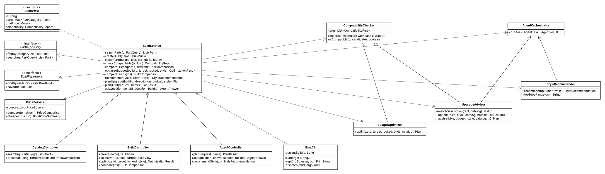
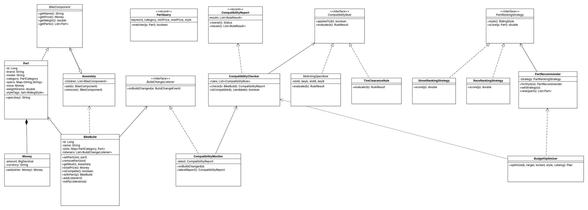
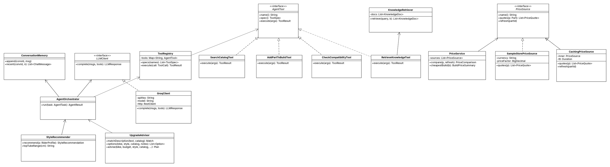
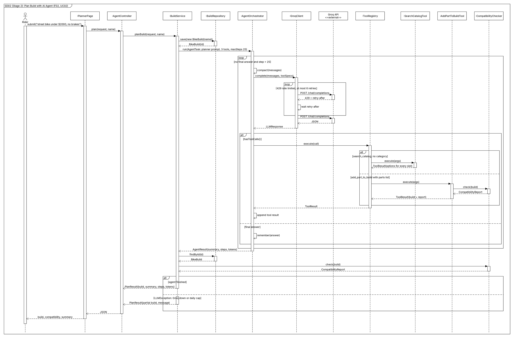
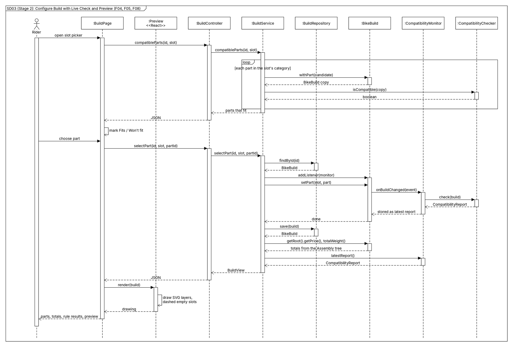
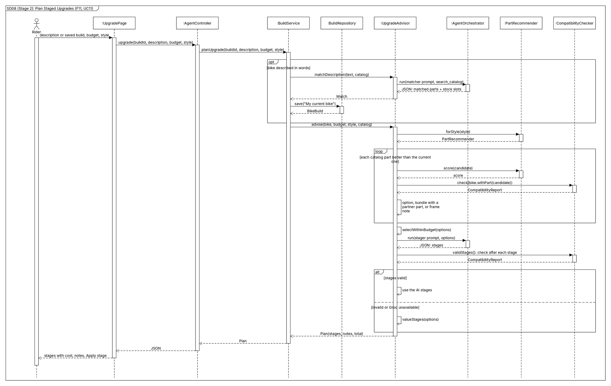

# BMX Build Agent: Stage 2 Implementation Report

**Student:** Salvador Mota Fragoso

**Repository:** [github.com/SalFragoso/EECS-3311BMX-Build-Agent](https://github.com/SalFragoso/EECS-3311BMX-Build-Agent)

**Implementation period:** October 20 to November 10, 2026

**Stage 1 report:** [Stage1-Report.md](Stage1-Report.md)

---

## 1. Project Overview and Implementation Status

### 1.1 What the Application Is

#### Problem

A custom BMX is 15 to 20 parts (frame, fork, bars, stem, cranks, sprocket, hubs, rims, tires, pedals, seat, brakes and more) picked from dozens of brands. The parts have to fit together. The bottom bracket has to match the cranks, the fork has to match the frame's head tube, hub axles have to fit the dropouts, and the tires have to clear the frame. On top of that, prices for the same part change from store to store, and the right parts depend on the rider's height and riding style (street, park, dirt, flatland or race).

Right now all of this is spread across store pages, spec sheets and forums. Beginners often buy parts that don't fit, and once a part is installed it usually can't be returned. Even experienced riders spend a lot of time pricing out a build.

BMX Build Agent is a web app that helps riders plan, check, price and preview a full BMX build. Its AI agent can turn a plain request like "street bike under $900" into a complete build where every part fits.

#### Target Users

- Beginner and intermediate riders building their first custom bike or upgrading a stock one
- Experienced riders pricing out a new build or comparing setups
- Bike shop staff putting together and quoting builds for customers

#### How It Is Built

The system is a Spring Boot 4 backend (Java 21, PostgreSQL) with two front ends that both go through the same `BuildService` facade:

- **GUI:** a React 18 single page app with seven tabs (Build, Catalog, AI Planner, Upgrade, Ask, My Profile, My Builds). It is built by Vite into the Spring Boot static folder and served at `http://localhost:8080`.
- **CLI:** an interactive shell (`BmxCli`, about 20 commands) started with the `cli` Spring profile. It reaches every feature except the drawn preview (F08), which is visual by nature.

### 1.2 AI and LLM Integration

The LLM is **GPT-OSS 120B on Groq** (`openai/gpt-oss-120b`, free tier), called through Groq's OpenAI compatible chat completions API with tool calling. Stage 1 planned Llama 3.3 70B, but Groq shut that model down in August 2026, and swapping it was a one-line config change because the app talks to the LLM only through the `LLMClient` interface (Section 4, C14).

#### Why an AI Agent

Planning a build is a step-by-step search where every choice affects the next one. The frame decides the bottom bracket type, which limits the cranks, which changes how much budget is left for everything else. Requests are open-ended and different for every rider, so a fixed form can't handle them.

An agent fits this well. The LLM reads the request, picks which tool to use next, looks at the result and adjusts its plan. Anything that has to be correct (compatibility, prices, totals) is done by deterministic code that the agent calls as a tool. The LLM is never trusted for facts the system can look up, and every build it suggests is checked by the compatibility checker before the user sees it.

#### What Makes It an Agent

The AI part is a real agent, not a prompt forwarder:

- **Tool use and multi-step execution.** `AgentOrchestrator` runs a loop: send the conversation and the allowed tool specs to the LLM, run any tool calls it asks for through `ToolRegistry`, feed the results back, and repeat until it answers or hits the step limit (25 for the planner). Groq's free tier allows about 8,000 tokens a minute, so `GroqClient` waits and retries when it is rate limited, and the orchestrator shortens older tool results before each call (C15).
- **Tools that act on real data.** `search_catalog`, `add_part_to_build`, `check_compatibility` and `search_knowledge` each wrap deterministic code. The planner actually fills a saved build, and every part it adds is checked by the compatibility rules. It gets options for every slot from one search and adds all its picks in one call, so a full plan takes about 3 to 6 tool calls.
- **Retrieval.** `KnowledgeRetriever` ranks ten BMX knowledge articles by keyword score. The Q&A agent retrieves them as a tool, and the style recommender gets the matching articles in its context.
- **Memory.** `ConversationMemory` keeps the last 20 messages per conversation, so follow-up questions in the Ask tab work.
- **Decision making with checks.** For F01, F07 and F11 the LLM makes the judgement call (style ranking, how to explain swaps, how to group upgrades into stages) and Java code validates it. If the output is unusable or Groq is down, a deterministic fallback runs and the UI labels it as such.

### 1.3 Current Working Functionality

All eleven Stage 1 features are implemented and reachable from the GUI, and all but F08 from the CLI. No Stage 1 feature was dropped or replaced. Seven design patterns are implemented.

| ID | Feature | Status | Type | GUI tab | CLI commands |
|---|---|---|---|---|---|
| F01 | Rider profile and style recommendation | Modified | Hybrid | My Profile | `recommend` |
| F02 | AI build planner | Modified | AI | AI Planner | `plan` |
| F03 | Parts catalog search and filter | Implemented | Deterministic | Catalog | `search` |
| F04 | Interactive build configurator | Implemented | Deterministic | Build | `new`, `use`, `show`, `add`, `remove`, `fits` |
| F05 | Compatibility checker | Implemented | Deterministic | Build (panel) | `check` |
| F06 | Price comparison | Modified | Deterministic | Catalog, Build | `prices`, `buildprices` |
| F07 | Budget optimizer | Implemented | Hybrid | Build (panel) | `optimize` |
| F08 | Live 2D build preview | Modified | Deterministic | Build (preview) | N/A (visual), `show` prints the parts |
| F09 | BMX Q&A assistant | Implemented | AI | Ask | `ask` |
| F10 | Saved builds and side-by-side comparison | Modified | Deterministic | My Builds | `builds`, `rename`, `copy`, `delete`, `compare` |
| F11 | Upgrade path advisor | Implemented | Hybrid | Upgrade | `upgrade` |

*Table 1. Implementation status. "Modified" means it works, but differs from the Stage 1 design in a way explained in Section 4.*

### 1.4 Limitations and Incomplete Functionality

- **Prices are sample data.** F06 compares three sample stores (two in CAD, one in USD converted at a fixed rate). There is no free public BMX retailer price API, so the live store adapter from Stage 1 was not built. The comparison, caching and conversion logic is real and would work unchanged with a live source.
- **Small catalog.** The database is seeded with 34 sample parts. That is enough to plan full builds in every style, but the agent's choices are limited by it.
- **No user accounts.** Saved builds are shared by everyone using the same database, and the rider profile is kept in the browser. Login was never a required feature, so I left it out.
- **The preview is a drawing.** F08 draws layered shapes coloured by part, not photos.
- **LLM quality and limits.** Answers from the LLM vary between runs, and Groq's free tier allows only about 8,000 tokens a minute and 200,000 a day. The app waits and retries instead of failing, so on a free key the planner and upgrade advisor can take a minute or two. Every AI feature has a fallback or a clear error (HTTP 503 with a message), but the AI parts will be weaker when Groq is slow or unavailable.
- **Testing depth.** Stage 2 has 151 JUnit tests (Section 6.2). Full deterministic testing and agent validation are Stage 3 work.

---

## 2. Feature to Implementation Mapping

Every Stage 1 feature (F01 to F11) is accounted for below. There are no new feature IDs. Extras such as PNG export or rename and duplicate are extensions of an existing feature and are listed under it. Paths are relative to `backend/src/main/java/com/salvador/bmxbuilder/` for Java and `frontend/src/` for React. All REST controllers call only `BuildService`, and so does the CLI.

### F01 Rider Profile and Style Recommendation

|  |  |
|---|---|
| **Feature ID and name** | F01 - Rider profile and style recommendation |
| **Stage 1 reference** | F01, UC01, SD01 |
| **Status or change** | Modified. The profile is kept in the browser instead of a `ProfileRepository`, and knowledge articles are retrieved directly instead of through the agent's tool (Section 4, C1 and C2). |
| **Implemented classes/files and responsibilities** | - `pages/ProfilePage.jsx`: the profile form (height, experience, where they ride, goals, budget, brakes or not). Saves the form and result in local storage. - `web/AgentController`: `POST /api/agent/recommend-style`, validates input. - `service/BuildService`: facade entry point. - `recommend/RiderProfile`: the rider's answers, with `validate()`. - `recommend/StyleRecommender`: works out the frame top tube range from height, collects facts and retrieved articles, asks the LLM to rank the five styles, parses the JSON and falls back to a rule-based score. - `recommend/StyleRecommendation`: ranked styles with reasons, frame range, and whether it is AI or basic. - `agent/AgentOrchestrator`, `agent/Prompts.styleRecommender()`, `agent/llm/GroqClient`, `agent/knowledge/KnowledgeRetriever`. - `cli/BmxCli`: `recommend` asks the same questions in the terminal. |
| **Key methods** | `AgentController.recommendStyle()`, `BuildService.recommendStyle()`, `RiderProfile.validate()`, `StyleRecommender.recommend()`, `topTubeRange()`, `quizFacts()`, `parseRanking()`, `ruleBased()`, `KnowledgeRetriever.retrieve()`, `AgentOrchestrator.run()`, `GroqClient.complete()` |
| **Design patterns** | Facade (`BuildService`), Adapter (`GroqClient`) |
| **Video link/timestamp** | GUI [0:20](https://youtu.be/-6DjryrGpz4?t=20) CLI [0:25](https://youtu.be/P5qlGrulmjk?t=25) |

**How it works.** The form posts the profile to `AgentController`, which validates it and calls `BuildService.recommendStyle()`. `StyleRecommender` first does the deterministic part: the top tube range from the rider's height. It then builds a fact sheet from the answers and pulls the most relevant knowledge articles with `KnowledgeRetriever`, and runs a no-tools `AgentTask` with the style prompt. The LLM returns a JSON ranking with a reason per style. If that JSON cannot be read it retries once, and if it still fails (or Groq is down) `ruleBased()` scores the styles from the answers and the result is labelled "basic". The page shows the ranking, the frame size and the reasons, and can open the planner with that style.

**Type:** Hybrid. Frame sizing and the fallback are deterministic, and the style ranking and reasons come from the LLM.

### F02 AI Build Planner

|  |  |
|---|---|
| **Feature ID and name** | F02 - AI build planner |
| **Stage 1 reference** | F02, UC02, SD02 |
| **Status or change** | Modified. The agent's price tool was replaced by an `add_part_to_build` tool, and the planner has its own GUI tab (Section 4, C3). |
| **Implemented classes/files and responsibilities** | - `pages/PlannerPage.jsx`: request box (style, budget, needs in plain words) and the result with the agent's reasons. - `web/AgentController`: `POST /api/agent/plan`. - `service/BuildService.planBuild()`: creates and saves an empty build, starts the agent task with the planner tools, reloads the build, checks it and returns a `PlanResult`. - `agent/AgentOrchestrator`: the tool-use loop, step limit and memory. - `agent/tools/ToolRegistry`, `SearchCatalogTool` (an all-slots overview when no category is given), `AddPartToBuildTool` (one part or a whole list), `CheckCompatibilityTool`: what the agent is allowed to do. - `agent/ConversationMemory`: keeps the plan conversation. - `agent/llm/LLMClient` and `GroqClient`: the LLM call. - `domain/compatibility/CompatibilityChecker`: checks each part the agent adds. - `cli/BmxCli`: `plan <request>`. |
| **Key methods** | `BuildService.planBuild()`, `AgentOrchestrator.run()`, `handleToolCalls()`, `ToolRegistry.execute()`, `SearchCatalogTool.execute()`, `AddPartToBuildTool.execute()`, `CheckCompatibilityTool.execute()`, `GroqClient.complete()`, `ConversationMemory.append()`, `CompatibilityChecker.check()` |
| **Design patterns** | Command (tools), Adapter (`GroqClient`), Facade, Observer (each `setPart()` notifies the monitor) |
| **Video link/timestamp** | GUI [1:43](https://youtu.be/-6DjryrGpz4?t=103) CLI [1:05](https://youtu.be/P5qlGrulmjk?t=65) |

**How it works.** The rider types something like "street bike under $1500, no brakes". `BuildService.planBuild()` saves a new empty build and runs an `AgentTask` with the planner prompt, the build id as context, and only three tools. In the loop the LLM first calls `search_catalog` with no category, which lists up to four options for every slot, then adds all its picks in one `add_part_to_build` call (which loads the build, calls `setPart()` for each part and saves it once). The tool's reply includes the compatibility report, and if a rule fails the LLM replaces just that part. If a tool returns an error, for example an unknown part id or a clash, the error goes back to the LLM so it can fix its choice. When it stops calling tools, its last message is the summary. The service reloads the build, runs the checker once more and returns the build, the summary, the tool steps and the token count. If Groq fails part way, the parts already added are kept and the page says the plan is incomplete.

**Type:** AI. The LLM decides which parts to pick, but every change goes through deterministic tools and the compatibility rules.

### F03 Parts Catalog Search and Filter

|  |  |
|---|---|
| **Feature ID and name** | F03 - Parts catalog search and filter |
| **Stage 1 reference** | F03, UC03, SD04 |
| **Status or change** | Implemented as designed. |
| **Implemented classes/files and responsibilities** | - `pages/CatalogPage.jsx`: keyword box and filters (category, min and max price, style), results grid, price comparison and an "add to build" button. - `web/CatalogController`: `GET /api/parts` with query parameters, `GET /api/parts/{id}`. - `service/BuildService.searchParts()`: facade entry. - `domain/PartQuery`: a record of the filters with `matches(part)`. - `data/PartRepository`: JPA repository with `findByCategory()` and a default `search(query)` that applies `PartQuery.matches`. - `data/SampleDataLoader`: seeds the 34 sample parts at start up. - `cli/BmxCli`: `search [text] [--cat X] [--style Y] [--max N]`. |
| **Key methods** | `CatalogController.search()`, `BuildService.searchParts()`, `PartRepository.search()`, `findByCategory()`, `PartQuery.matches()` |
| **Design patterns** | Facade |
| **Video link/timestamp** | GUI [2:35](https://youtu.be/-6DjryrGpz4?t=155) CLI [2:07](https://youtu.be/P5qlGrulmjk?t=127) |

**How it works.** The page sends the filters as query parameters. Spring binds them into a `PartQuery` (bad values such as an unknown category return a 400 with a readable message). `BuildService` passes the query to `PartRepository.search()`, which narrows by category in SQL when one is given and then keeps the parts for which `PartQuery.matches()` is true (every word of the keyword found in the brand and model, style tag, price range). A minimum above the maximum is rejected. The results are sorted by price and shown as cards.

**Type:** Deterministic.

### F04 Interactive Build Configurator

|  |  |
|---|---|
| **Feature ID and name** | F04 - Interactive build configurator |
| **Stage 1 reference** | F04, UC04, SD03 |
| **Status or change** | Implemented. Added a "compatible parts" filter for the part picker (Section 4, C9). |
| **Implemented classes/files and responsibilities** | - `pages/BuildPage.jsx`: slot list, part picker with "Fits / Won't fit" labels, totals, missing slots. - `web/BuildController`: create, get, `PUT /parts/{slot}`, `DELETE /parts/{slot}`, `GET /compatible-parts`. - `service/BuildService`: `createBuild()`, `viewBuild()`, `selectPart()`, `removePart()`, `compatibleParts()`. - `domain/BikeBuild`: the build. Holds a part per slot, raises change events, builds the part tree. - `domain/Assembly`, `domain/Part`, `domain/BikeComponent`: the Composite tree used for totals. - `data/BuildRepository`: saves builds. - `service/BuildView`: what the UI receives (parts, totals, missing slots, compatibility). - `cli/BmxCli`: `new`, `use`, `show`, `add <slot> <id>`, `remove <slot>`, `fits <slot>`. |
| **Key methods** | `BuildService.selectPart()`, `compatibleParts()`, `BikeBuild.setPart()`, `removePart()`, `getRoot()`, `totalPrice()`, `totalWeight()`, `missingSlots()`, `Assembly.getPrice()`, `CompatibilityChecker.isCompatible()` |
| **Design patterns** | Composite, Observer, Facade |
| **Video link/timestamp** | GUI [3:23](https://youtu.be/-6DjryrGpz4?t=203) CLI [2:58](https://youtu.be/P5qlGrulmjk?t=178) |

**How it works.** When the rider opens a slot, the page asks for compatible parts: `compatibleParts()` tries each part of that category with `BikeBuild.withPart()` and `CompatibilityChecker.isCompatible()`, so the picker can mark parts that would not fit. Choosing one calls `selectPart()`, which loads the build, registers a `CompatibilityMonitor`, and calls `setPart()`. The build replaces the slot and notifies its listeners, so the monitor re-checks. `BuildView` then reads totals from the root `Assembly` (frame set, drivetrain, wheels, cockpit), which adds up its children recursively. The page redraws the slot list, totals, compatibility panel and preview from the returned view.

**Type:** Deterministic.

### F05 Compatibility Checker

|  |  |
|---|---|
| **Feature ID and name** | F05 - Compatibility checker |
| **Stage 1 reference** | F05, UC05, SD03 |
| **Status or change** | Implemented with more rules than Stage 1. `AxleDropoutRule` became separate front and rear axle rules, and three drivetrain rules were added (Section 4, C7). |
| **Implemented classes/files and responsibilities** | - `domain/compatibility/CompatibilityChecker`: runs every rule that applies and builds the report. - `CompatibilityRule`: interface with `name()`, `appliesTo(build)`, `evaluate(build)`. - `MatchingSpecRule`: shared base for rules that compare one spec of two slots. - Seven rules: `BottomBracketRule`, `CrankSpindleRule`, `SprocketBoreRule`, `HeadTubeRule`, `FrontAxleRule`, `RearAxleRule`, `TireClearanceRule`. - `CompatibilityReport`, `RuleResult`, `Status`: overall result (PASS, WARNING, FAIL) and one line per rule. - `CompatibilityMonitor`: Observer that re-checks when the build changes. - `agent/tools/CheckCompatibilityTool`: lets the agent run the checker. - `BuildController`: `GET /api/builds/{id}/compatibility`. CLI: `check`. |
| **Key methods** | `CompatibilityChecker.check()`, `isCompatible()`, `CompatibilityRule.appliesTo()`, `evaluate()`, `TireClearanceRule.tireWidth()`, `CompatibilityMonitor.onBuildChanged()`, `latestReport()`, `CheckCompatibilityTool.execute()` |
| **Design patterns** | Observer (`CompatibilityMonitor`), Command (exposed to the agent as a tool) |
| **Video link/timestamp** | GUI [4:35](https://youtu.be/-6DjryrGpz4?t=275) CLI [3:43](https://youtu.be/P5qlGrulmjk?t=223) |

**How it works.** Each part stores its standards as specs (for example a frame's `bbType` and `rearAxle`). The checker runs every rule whose two slots are filled. A matching rule passes when both specs agree, fails when they differ and gives a warning when a spec is missing. `TireClearanceRule` compares the tire width with the frame and fork clearance. The worst result becomes the overall status. The same checker serves the Build page panel, the picker filter, the planner's tool, the budget optimizer and the upgrade advisor, so every feature agrees on what "fits" means.

**Type:** Deterministic.

### F06 Price Comparison

|  |  |
|---|---|
| **Feature ID and name** | F06 - Price comparison |
| **Stage 1 reference** | F06, UC06, SD04 |
| **Status or change** | Modified. Prices come from three sample store sources instead of a live retailer API adapter (Section 4, C4). |
| **Implemented classes/files and responsibilities** | - `pages/CatalogPage.jsx` (per part) and `pages/BuildPage.jsx` (whole build): price tables with the cheapest marked. - `web/CatalogController`: `GET /api/parts/{id}/prices`. `BuildController`: `GET /api/builds/{id}/prices`. - `pricing/PriceService`: `compare(part)` and `cheapestBuild(build)` over all sources. - `pricing/PriceSource`: interface with `name()`, `quotes(part)`, `refresh()`. - `pricing/SampleStorePriceSource`: one store with its currency, price factor and shipping. - `pricing/CachingPriceSource`: Decorator that caches another source for 10 minutes. - `pricing/CurrencyConverter`: converts USD quotes to CAD. - `pricing/PricingConfig`: Spring config that wires the three sources, each wrapped in the cache. - `pricing/PriceQuote`, `PriceComparison`, `BuildPriceSummary`: result types. CLI: `prices <id>`, `buildprices`. |
| **Key methods** | `BuildService.comparePrices()`, `buildPrices()`, `PriceService.compare()`, `cheapestBuild()`, `PriceSource.quotes()`, `CachingPriceSource.quotes()`, `refresh()`, `CurrencyConverter.convert()` |
| **Design patterns** | Decorator (`CachingPriceSource`), Facade |
| **Video link/timestamp** | GUI [5:04](https://youtu.be/-6DjryrGpz4?t=304) CLI [4:21](https://youtu.be/P5qlGrulmjk?t=261) |

**How it works.** `PriceService` asks every configured `PriceSource` for quotes. Each one is a `CachingPriceSource` wrapped around a `SampleStorePriceSource`, so a repeat lookup within ten minutes is served from the cache. USD quotes are converted to CAD and shipping is added, then the quotes are sorted and the cheapest is marked. Out-of-stock offers go last, and a store that fails is listed instead of breaking the page. For a whole build, `cheapestBuild()` takes the cheapest in-stock offer for each part (falling back to the list price when no store has it) and shows the total and the saving against list price.

**Type:** Deterministic.

### F07 Budget Optimizer

|  |  |
|---|---|
| **Feature ID and name** | F07 - Budget optimizer |
| **Stage 1 reference** | F07, UC07, SD05 |
| **Status or change** | Implemented. All five ranking strategies exist (Stage 1 had three, with dirt and flatland planned). |
| **Implemented classes/files and responsibilities** | - `pages/BuildPage.jsx`: target budget, style, locked slots, the suggested swaps and an Apply button. - `web/BuildController`: `POST /api/builds/{id}/optimize`, `POST /apply-swaps`. - `service/BuildService`: `optimizeBudget()` and `applySwaps()`. - `recommend/BudgetOptimizer`: finds cheaper, compatible swaps that lose the least quality per dollar saved. - `recommend/PartRecommender`: holds the current `PartRankingStrategy` and scores parts. - `recommend/PartRankingStrategy` and `StreetRankingStrategy`, `ParkRankingStrategy`, `RaceRankingStrategy`, `DirtRankingStrategy`, `FlatlandRankingStrategy`. - `agent/Prompts.budgetExplainer()` with `AgentOrchestrator`: the LLM explains the plan. - `service/OptimizationResult`. CLI: `optimize <budget> [--lock slots] [--style S] [--apply]`. |
| **Key methods** | `BudgetOptimizer.optimize()`, `lossPerDollar()`, `PartRecommender.forStyle()`, `setStrategy()`, `score()`, `rank()`, `PartRankingStrategy.score()`, `CompatibilityChecker.isCompatible()`, `BuildService.applySwaps()` |
| **Design patterns** | Strategy, Facade, Adapter (for the explanation) |
| **Video link/timestamp** | GUI [5:41](https://youtu.be/-6DjryrGpz4?t=341) CLI [4:49](https://youtu.be/P5qlGrulmjk?t=289) |

**How it works.** `BudgetOptimizer` picks the ranking strategy for the rider's style and, for every unlocked slot, looks for cheaper catalog parts that keep the build compatible. It repeatedly takes the swap with the smallest score loss per dollar saved until the build is under the target or no swaps are left, and reports if the target cannot be reached. `BuildService` then sends the plan to the LLM, which writes a short explanation of the trade-offs. If Groq is down, a plain text reason per swap is used instead. Apply runs each swap through `selectPart()` so the normal checks and events happen.

**Type:** Hybrid. The swaps are chosen deterministically, and the explanation comes from the LLM.

### F08 Live 2D Build Preview

|  |  |
|---|---|
| **Feature ID and name** | F08 - Live 2D build preview |
| **Stage 1 reference** | F08, UC08, SD03 |
| **Status or change** | Modified. Drawing moved from a server-side `PreviewRenderer` to a React component, and PNG export was added (Section 4, C5). |
| **Implemented classes/files and responsibilities** | - `Preview.jsx`: draws the bike as SVG layers (frame, fork, bars, wheels, tires, cranks, sprocket, seat, pegs, brakes) from the parts in the current `BuildView`. Frame colour comes from the part's colour spec. Missing parts are drawn as dashed outlines. Export saves the drawing as a PNG. - `pages/BuildPage.jsx`: shows the preview next to the slot list and passes it the latest build. - `api.js`: every build change returns a fresh `BuildView`, which triggers the redraw. - Backend: `BuildView` gives each part's `imageLayer` and specs. |
| **Key methods** | `Preview()` render, `exportPng()`, `BuildService.viewBuild()`, `BikeBuild.getRoot()` |
| **Design patterns** | Composite (the view lists the parts from the build tree). The server Observer now drives only the compatibility monitor. |
| **Video link/timestamp** | GUI [7:02](https://youtu.be/-6DjryrGpz4?t=422) CLI: not applicable (visual feature) |

**How it works.** Every change on the Build page (pick, remove, apply swaps, AI plan) returns the updated `BuildView`. React state changes, and `Preview` redraws the SVG layers for the parts that are present, using the colour spec and showing empty slots as outlines. Export draws the SVG onto a canvas and downloads a PNG. Nothing is sent to the server for the drawing.

**Type:** Deterministic.

### F09 BMX Q&A Assistant

|  |  |
|---|---|
| **Feature ID and name** | F09 - BMX Q&A assistant |
| **Stage 1 reference** | F09, UC09, SD06 |
| **Status or change** | Implemented as designed. |
| **Implemented classes/files and responsibilities** | - `pages/AskPage.jsx`: chat view with the question box, each answer with its sources, and a checkbox to include the current build. - `web/AgentController`: `POST /api/agent/ask`. - `service/BuildService.askQuestion()`: adds the current build summary as context and runs a Q&A task. - `agent/AgentOrchestrator` with `ConversationMemory`: follow-up questions see earlier turns. - `agent/tools/RetrieveKnowledgeTool` (`search_knowledge`) and `SearchCatalogTool`. - `agent/knowledge/KnowledgeRetriever`, `BmxKnowledgeBase` (10 articles), `KnowledgeDoc`. - `service/AgentAnswer`. CLI: `ask <question>`. |
| **Key methods** | `BuildService.askQuestion()`, `AgentOrchestrator.run()`, `ConversationMemory.recent()`, `append()`, `RetrieveKnowledgeTool.execute()`, `KnowledgeRetriever.retrieve()`, `score()`, `SearchCatalogTool.execute()`, `GroqClient.complete()` |
| **Design patterns** | Command, Adapter, Facade |
| **Video link/timestamp** | GUI [7:52](https://youtu.be/-6DjryrGpz4?t=472) CLI [5:32](https://youtu.be/P5qlGrulmjk?t=332) |

**How it works.** The question and a conversation id go to `askQuestion()`. If a build is selected, a summary of it is added as context. The orchestrator loads the recent messages for that conversation and gives the LLM two tools. For a standards question it calls `search_knowledge`, and `KnowledgeRetriever` returns the top scored articles. For "what should I buy" it can also search the catalog. The answer, the articles used and the tool steps go back to the page, and the turn is stored so the next question has context. If Groq is down, the matching articles are still returned and the page says the AI answer is unavailable.

**Type:** AI. Retrieval is deterministic, the answer is written by the LLM.

### F10 Saved Builds and Side-by-side Comparison

|  |  |
|---|---|
| **Feature ID and name** | F10 - Saved builds and side-by-side comparison |
| **Stage 1 reference** | F10, UC10, SD07 |
| **Status or change** | Modified. `SavedBuildsController` was merged into `BuildController`, there is no owner per build, and rename, duplicate and delete were added (Section 4, C6). |
| **Implemented classes/files and responsibilities** | - `pages/BuildsPage.jsx`: list of saved builds with totals and status, open, rename, duplicate, delete, and a comparison table for two or three builds. - `web/BuildController`: `GET /api/builds`, `PATCH` rename, `POST /duplicate`, `DELETE`, `GET /compare?ids=`. - `service/BuildService`: `listBuilds()`, `renameBuild()`, `duplicateBuild()`, `deleteBuild()`, `compareBuilds()`. - `service/BuildComparison`: per slot rows, price and weight differences, both compatibility results. - `data/BuildRepository`, `domain/BikeBuild`. CLI: `builds`, `rename`, `copy`, `delete`, `compare <a> <b>`. |
| **Key methods** | `BuildService.listBuilds()`, `renameBuild()`, `duplicateBuild()`, `deleteBuild()`, `compareBuilds()`, `BikeBuild.getPart()`, `totalPrice()`, `totalWeight()` |
| **Design patterns** | Facade, Composite (totals) |
| **Video link/timestamp** | GUI [8:30](https://youtu.be/-6DjryrGpz4?t=510) CLI [6:17](https://youtu.be/P5qlGrulmjk?t=377) |

**How it works.** Builds are saved as soon as they are created, so the list simply reads them back with their totals and status. Duplicate copies every slot into a new build. Compare loads two or three builds, makes one row per slot showing each build's part, flags the slots that differ, totals each build through its root `Assembly` and runs the checker on each. Duplicate build names are rejected.

**Type:** Deterministic.

### F11 Upgrade Path Advisor

|  |  |
|---|---|
| **Feature ID and name** | F11 - Upgrade path advisor |
| **Stage 1 reference** | F11, UC11, SD08 |
| **Status or change** | Implemented. Clashing upgrades that one extra part can fix are offered as bundles, and frame limits are reported as notes (Section 4, C11). |
| **Implemented classes/files and responsibilities** | - `pages/UpgradePage.jsx`: pick a saved build or describe your bike in words, set budget and style, see the stages, apply a stage. - `web/AgentController`: `POST /api/agent/upgrade`. - `service/BuildService.planUpgrade()`: turns a description into a saved "My current bike" build if needed, then asks the advisor. - `recommend/UpgradeAdvisor`: matches a description to catalog parts with the LLM, lists scored upgrade options, keeps what fits the budget, asks the LLM to stage them and validates the stages. - `recommend/PartRecommender` (Strategy), `domain/compatibility/CompatibilityChecker`. - `agent/Prompts.bikeMatcher()`, `upgradeStager()`, `AgentOrchestrator`, `SearchCatalogTool`. - CLI: `upgrade <budget> [--style S] [--describe text] [--apply-stage N]`. |
| **Key methods** | `BuildService.planUpgrade()`, `UpgradeAdvisor.matchDescription()`, `advise()`, `options()`, `clashesWith()`, `selectWithinBudget()`, `validStages()`, `valueStages()`, `PartRecommender.score()`, `CompatibilityChecker.check()` |
| **Design patterns** | Strategy, Command, Facade, Adapter |
| **Video link/timestamp** | GUI [9:02](https://youtu.be/-6DjryrGpz4?t=542) CLI [7:28](https://youtu.be/P5qlGrulmjk?t=448) |

**How it works.** If the rider describes their bike, a matcher agent with only `search_catalog` maps the description to catalog parts and reports which slots are stock. Those become a saved build. `advise()` then scores every catalog part against the current part with the style's strategy (stock parts get a bonus so they are upgraded first). Each candidate is tried on the bike: if it clashes and one partner part makes the rule pass, the two become a bundle; if the frame is the limit, a note says so. Options that fit the budget go to a second agent, which groups them into up to three stages with reasons. Java checks the stages (known options, no repeats, within budget, still compatible after each stage). If they fail, or Groq is down, `valueStages()` groups them by value instead. "Apply stage" uses the same swap path as F07.

**Type:** Hybrid. Matching and staging are done by the LLM, scoring, compatibility and validation are deterministic.

---

## 3. Implemented Design Patterns

Seven distinct patterns from the course are implemented. All seven were in the Stage 1 design. Two changed in scope (Observer and Adapter), as explained in their rows and in Section 4.

| Pattern | Category | Problem it solves here | Main classes | Matches Stage 1? |
|---|---|---|---|---|
| Composite | Structural | Totals across a tree of parts and groups | `BikeComponent`, `Part`, `Assembly`, `BikeBuild` | Yes |
| Observer | Behavioural | React to build changes without coupling | `BikeBuild`, `BuildChangeListener`, `CompatibilityMonitor` | Partly (preview moved to the client) |
| Facade | Structural | One entry point for GUI, REST and CLI | `BuildService` | Yes |
| Adapter | Structural | Groq's API behind a provider-neutral interface | `LLMClient`, `GroqClient` | Partly (no store API adapter) |
| Command | Behavioural | Agent actions as objects the LLM can call | `AgentTool`, four tools, `ToolRegistry` | Yes (one tool swapped) |
| Strategy | Behavioural | Ranking parts differently per riding style | `PartRankingStrategy`, five strategies, `PartRecommender` | Yes (all five built) |
| Decorator | Structural | Add caching to any price source | `PriceSource`, `CachingPriceSource` | Yes |

### 3.1 Composite

|  |  |
|---|---|
| **Problem** | A bike is a tree. The build has assemblies (front end, drivetrain, wheels) and assemblies have parts. Price and weight need to be added up across the whole tree, and the code shouldn't care if it's holding one part or a whole assembly. |
| **Roles** | `BikeComponent` (abstract) is the Component with `getName()`, `getPrice()`, `getWeight()` and `getParts()`. `Part` is the Leaf. `Assembly` is the Composite and holds a list of `BikeComponent` children. `BikeBuild` is the Client and builds the root `Assembly`. |
| **Files and methods** | `domain/BikeComponent.java`, `Part.java` (`getPrice()`, `getParts()` returns itself), `Assembly.java` (`add()`, `remove()`, `getChildren()`, `getPrice()`, `getWeight()`, `getParts()`), `BikeBuild.java` (`getRoot()`, `totalPrice()`, `totalWeight()`), `Money.add()`. Used by `BuildView`, `BuildComparison` and the agent's `BuildSummary`. |
| **How it follows the pattern and why it helps** | `Assembly.getPrice()` adds `child.getPrice()` for each child, and a child may be a part or another assembly, so the recursion handles any depth. `totalPrice()` is one call on the root. A new group (for example a separate cockpit assembly) changes only `getRoot()`, not any totalling code. Tested in `AssemblyTest` and `BikeBuildTest`. |
| **Why it fits** | Totals, weight and "list every part" (used by the checker and the preview) are each one recursive call. Adding a new group like a cockpit assembly doesn't change any totalling code. |
| **Without it** | `BikeBuild` would need hard-coded loops over every slot and group, copied into every place that totals or lists parts. Adding a group would mean editing all of them. |
| **Stage 1 match** | Matches. One implementation detail differs: the build stores a part per slot (easy to persist with JPA) and `getRoot()` builds the tree from those slots on demand instead of storing the tree itself. Clients still only see the Composite. |

### 3.2 Observer

|  |  |
|---|---|
| **Problem** | When a part changes, the compatibility result must be updated. `BikeBuild` should not know about the checker, and new reactions should be addable without editing the build. |
| **Roles** | `BikeBuild` is the Subject (`addListener()`, `removeListener()`, private `notifyListeners()`). `BuildChangeListener` is the Observer interface with `onBuildChanged(BuildChangeEvent)`. `CompatibilityMonitor` is the Concrete Observer. `BuildChangeEvent` carries the slot, the old part and the new part. |
| **Files and methods** | `domain/BikeBuild.java` (`setPart()` and `removePart()` call `notifyListeners()`), `domain/BuildChangeListener.java`, `domain/BuildChangeEvent.java`, `domain/compatibility/CompatibilityMonitor.java` (`onBuildChanged()`, `latestReport()`). Registered in `BuildService.loadBuild()`. |
| **How it follows the pattern and why it helps** | The build only knows the listener interface. The monitor re-checks on each event and keeps the latest report, which the service reads into the `BuildView`. The agent's `add_part_to_build` tool goes through the same `setPart()`, so AI changes are checked the same way as manual ones. Tested in `BikeBuildTest` (listeners notified, removed listeners not notified). |
| **Stage 1 match** | Partly. In Stage 1 there were two observers, `CompatibilityMonitor` and a server `PreviewRenderer`. The preview is now drawn in React from the returned `BuildView` (Section 4, C5), so the server Observer has one concrete observer. The structure is unchanged and another listener can be added without touching `BikeBuild`. |

### 3.3 Facade

|  |  |
|---|---|
| **Problem** | A user action touches many subsystems (repositories, checker, agent, pricing, optimizer, advisor). The GUI controllers and the CLI should not each repeat that wiring, and they must behave the same. |
| **Roles** | `BuildService` is the Facade. The subsystems are `PartRepository`, `BuildRepository`, `CompatibilityChecker`, `AgentOrchestrator`, `KnowledgeRetriever`, `PriceService`, `BudgetOptimizer`, `StyleRecommender` and `UpgradeAdvisor`. The clients are `CatalogController`, `BuildController`, `AgentController` and `BmxCli`. |
| **Files and methods** | `service/BuildService.java`: one method per action (`searchParts`, `createBuild`, `selectPart`, `checkCompatibility`, `planBuild`, `askQuestion`, `recommendStyle`, `comparePrices`, `optimizeBudget`, `compareBuilds`, `planUpgrade` and others). `web/*Controller.java` and `cli/BmxCli.java` call only these. |
| **How it follows the pattern and why it helps** | Each controller method is a few lines: parse input, call one facade method, return the result. The CLI calls the same methods, so a feature works the same in both interfaces and is tested once in `BuildServiceTest` (27 tests with in-memory fakes). Subsystems can change without touching the interfaces. |
| **Why it fits** | It's what makes the GUI plus CLI requirement easy. The CLI gets the same agent behaviour for free, and the controllers stay small. |
| **Without it** | Every controller and the CLI would depend on most of the subsystem, the coordination code would be copied around, and the GUI and CLI could end up behaving differently. |
| **Stage 1 match** | Matches. |

### 3.4 Adapter

|  |  |
|---|---|
| **Problem** | The agent needs "send messages and tool specs, get text or tool calls back". Groq's HTTP API has its own JSON format. The agent should not depend on one provider's format. |
| **Roles** | `LLMClient` is the Target (`complete(messages, tools)`, `modelName()`). `GroqClient` is the Adapter. Groq's chat completions endpoint is the Adaptee. `AgentOrchestrator` is the Client. `ChatMessage`, `ToolSpec`, `ToolCall` and `LLMResponse` are the app's own types. |
| **Files and methods** | `agent/llm/LLMClient.java`, `GroqClient.java` (`complete()`, `toRequest()`, `send()`, `withRetries()`, `retryAfter()`, `fromResponse()`, `parseArguments()`), `LLMException.java`. |
| **How it follows the pattern and why it helps** | `toRequest()` turns app messages and tool specs into Groq's JSON, and `fromResponse()` turns Groq's reply (including tool calls with string-encoded arguments) back into an `LLMResponse`. HTTP and API errors become `LLMException`, which the features catch for their fallbacks. Provider quirks stay inside the adapter too: on a 429 it waits as long as Groq's `retry-after` header asks and retries, and for GPT-OSS it asks for low reasoning effort to save tokens. When Groq retired Llama 3.3, only the model name in the config changed. Because the orchestrator only sees `LLMClient`, the tests use `ScriptedLLMClient` instead of a network call, and switching provider means writing one new adapter. Tested in `GroqClientTest`. |
| **Stage 1 match** | Partly. Stage 1 also used Adapter for retailer price APIs (`RetailerApiAdapter`). No public BMX retailer API was available, so that adapter was not built (Section 4, C4). The LLM adapter, which is the main use, matches. |

### 3.5 Command

|  |  |
|---|---|
| **Problem** | The LLM decides at run time which action to take, by name and JSON arguments. Each action needs a schema the LLM can read, a way to run it, and errors the LLM can recover from. The orchestrator should not have a switch over every action. |
| **Roles** | `AgentTool` is the Command interface (`name()`, `spec()`, `execute(args)`). `SearchCatalogTool`, `AddPartToBuildTool`, `CheckCompatibilityTool` and `RetrieveKnowledgeTool` are Concrete Commands, and each holds its receiver (`PartRepository`, `BuildRepository`, `CompatibilityChecker`, `KnowledgeRetriever`). `ToolRegistry` is the Invoker. `AgentOrchestrator` is the Client that turns LLM tool calls into invocations. |
| **Files and methods** | `agent/tools/AgentTool.java`, the four tool classes, `ToolRegistry.java` (`register()`, `specs(names)`, `execute(name, args)`), `ToolResult.java`, `ToolArgs.java`, `Schemas.java`, `agent/AgentOrchestrator.handleToolCalls()`. |
| **How it follows the pattern and why it helps** | Each request is an object with its own schema and `execute()`. The registry looks tools up by name, gives each task only the tools it allows (the planner gets three, the Q&A agent two, the style agent none) and turns bad arguments into a `ToolResult.error` the LLM can read and fix. Adding a tool means one class and one registration. `AddPartToBuildTool` also accepts a list of parts, so one command can fill a whole build. That keeps the planner within Groq's free-tier limit. Tested in `AgentToolsTest` and `AgentOrchestratorTest`. |
| **Note** | The arguments come from the LLM when the tool runs instead of being stored in the command first, so this is a parameterized version of Command. The main benefit, the invoker not knowing what each action does, is the same. |
| **Why it fits** | Adding a new agent ability is one new class and one `register()` call. Every tool run goes through one place, which makes logging the agent's steps (shown in F02) and handling tool errors simple. |
| **Without it** | The orchestrator would need a growing `switch` on tool names that knows about every service, and the tool descriptions sent to the LLM would be kept separately from the code that runs them. |
| **Stage 1 match** | Matches, with one tool swapped: `GetPricesTool` was replaced by `AddPartToBuildTool` (Section 4, C3). |

### 3.6 Strategy

|  |  |
|---|---|
| **Problem** | The "best" part depends on riding style. Street riders want strong parts, race riders want light ones, park is in between. The ranking has to change at runtime based on the rider's profile. |
| **Roles** | `PartRankingStrategy` is the Strategy interface (`style()`, `score(part)`). `StreetRankingStrategy`, `ParkRankingStrategy`, `RaceRankingStrategy`, `DirtRankingStrategy` and `FlatlandRankingStrategy` are Concrete Strategies. `PartRecommender` is the Context (`setStrategy()`, `getStrategy()`, `score()`, `rank()`, `forStyle()`). `BudgetOptimizer` and `UpgradeAdvisor` are its clients. |
| **Files and methods** | `recommend/PartRankingStrategy.java`, the five strategy classes, `PartRecommender.java`, `BudgetOptimizer.optimize()`, `UpgradeAdvisor.options()`. |
| **How it follows the pattern and why it helps** | Each strategy weighs a part's specs and style tags in its own way. The rider's style picks the strategy at run time and the clients just call `score()`. Adding a style is one class. Tested in `BudgetOptimizerTest` (a race strategy keeps lighter parts than a street one) and `UpgradeAdvisorTest`. |
| **Why it fits** | Each style's rules live in one small class that can be tested on its own, and the optimizer and upgrade advisor share the same ranking. |
| **Without it** | `PartRecommender` would have a big `switch` on riding style that grows with every new style, and changing one style could break another. That breaks Open/Closed. |
| **Stage 1 match** | Matches. Stage 1 had three strategies with dirt and flatland planned. All five are now implemented. |

### 3.7 Decorator

|  |  |
|---|---|
| **Problem** | Store lookups are slow in real life and should be cached. Caching should not be copied into every price source, and `PriceService` should not need to know which sources are cached. |
| **Roles** | `PriceSource` is the Component (`name()`, `quotes(part)`, `refresh()`). `SampleStorePriceSource` is the Concrete Component. `CachingPriceSource` is the Decorator: it is a `PriceSource` and wraps another one. `PriceService` is the client. |
| **Files and methods** | `pricing/PriceSource.java`, `SampleStorePriceSource.java`, `CachingPriceSource.java` (`quotes()` checks a time-stamped map first, `refresh()` clears it and passes on), `PricingConfig.cached()`, `PriceService.compare()`. |
| **How it follows the pattern and why it helps** | `CachingPriceSource.quotes()` returns a cached entry when it is younger than ten minutes and otherwise calls the wrapped source and stores the result. `PricingConfig` wraps each store when it creates it, and `PriceService` treats all sources the same. Caching can be turned off, or another decorator (for example logging) stacked on, without changing any source. Tested in `PricingTest`. |
| **Why it fits** | Caching can be added to or removed from any source when setting up `PriceService`, without touching the source classes. `PriceService` can't tell the difference. |
| **Stage 1 match** | Matches. The concrete components are sample stores instead of the live adapter and local dataset (Section 4, C4). |

#### MVC

The GUI also follows MVC (React components as the View, REST controllers as the Controller, the domain behind `BuildService` as the Model). It's listed separately because the frameworks give a lot of that structure for free. The seven patterns above are in this project's own classes.

### 3.8 Updated UML Class Diagram

The implemented system is shown in three class diagrams so the text stays readable. Like the Stage 1 diagrams, they are UMLet diagrams. The `.uxf` files and a PNG of each are in [docs/diagrams/stage2/](diagrams/stage2/). Small value and result types (for example `BuildView`, `PlanResult`, `PriceQuote`) are left out, as in Stage 1.

*Figure 1. Architecture: React GUI and CLI, controllers, the BuildService facade and the subsystems it uses.*

*Figure 2. Domain: Composite (parts and assemblies), Observer (build events), compatibility rules and ranking strategies.*

*Figure 3. Agent and pricing: orchestrator, LLM Adapter, tool Commands, memory and retrieval, and the price Decorator.*

#### Main Design Decisions

- **One entry point.** The REST controllers and the CLI only talk to `BuildService`, so the GUI and CLI always behave the same.
- **The LLM provider can be swapped.** `AgentOrchestrator` depends on the `LLMClient` interface, not on Groq.
- **Anything that must be right is deterministic code.** `CompatibilityChecker`, `PriceService` and the price and weight totals are plain Java and easy to unit test. The LLM suggests, the code checks.

Compared with the Stage 1 class diagram: `ProfileRepository`, `SavedBuildsController`, `PreviewRenderer`, `GetPricesTool`, `RetailerApiAdapter`, `RetailerHttpClient`, `LocalDatasetPriceSource`, `AxleDropoutRule` and `TaskType` are gone. `AddPartToBuildTool`, `SampleStorePriceSource`, `CurrencyConverter`, `MatchingSpecRule`, five extra compatibility rules, `DirtRankingStrategy`, `FlatlandRankingStrategy`, `StyleRecommender` and `AgentTask` are new. Section 4 gives the reason for each.

### 3.9 Use-case and Sequence Diagrams

The eleven use cases from Stage 1 still describe what the user does, with two small differences: UC01 no longer saves the profile on the server (it stays in the browser), and UC10 has no "my builds" owner filter because there is no login. Three sequence diagrams changed enough to be redrawn. SD01, SD04, SD05, SD06 and SD07 still show the correct flow, with the class renames in Section 4 (for example the planner's price tool and the store adapter).

Each diagram uses the classes and methods from the class diagram. `alt`, `opt` and `loop` boxes show the different paths and error cases. A step done inside one object is drawn as a message to itself.

Calls from a React component to a controller are HTTP requests to the REST API. They're drawn as method calls to match the controller methods. The CLI calls the same `BuildService` methods as the controllers, so everything from `BuildService` onward is the same for CLI use.

*Figure 4. Updated SD02, AI build planner (F02): the agent fills a saved build through tools, with a fallback when Groq fails.*

*Figure 5. Updated SD03, configurator and live preview (F04, F05, F08): compatible-parts filter, Observer re-check, preview drawn in React.*

*Figure 6. Updated SD08, upgrade path advisor (F11): optional AI matching of a described bike, scored options, AI staging validated in Java.*

---

## 4. Changes and Rationale

Every difference between the Stage 1 design and the submitted code is listed here as Original design, Implemented change, Reason, Impact. No Stage 1 feature was removed or replaced by a different feature, and no new feature IDs were added, so the rows are modifications and extensions.

| # | Original design (Stage 1) | Implemented change | Reason | Impact (use cases, classes, patterns) |
|---|---|---|---|---|
| C1 | F01: the agent called `RetrieveKnowledgeTool` while ranking styles. | `StyleRecommender` retrieves the articles itself and passes them in the prompt. The LLM gets no tools, has 2 steps, one retry on bad JSON, then a rule-based fallback. | The articles needed are known from the quiz answers, so a tool round trip only cost tokens and time. The fallback keeps F01 working when Groq is down. | UC01, SD01. New `StyleRecommender`. Command not used in F01. User need unchanged. |
| C2 | F01: profile saved in `ProfileRepository` and reused by other features. | Profile kept in browser local storage and sent with each request that needs it. | There are no user accounts, so a server profile would be shared by everyone. Keeping it client side avoids a profile table. | UC01 postcondition, `ProfileRepository` removed. Other features take style and budget as inputs. |
| C3 | F02: agent tools were search, compatibility, prices (`GetPricesTool`) and knowledge. The plan was assembled at the end. | `GetPricesTool` replaced by `AddPartToBuildTool`. The agent fills a saved build step by step. The planner has its own tab and `AgentController` endpoint. | Search results already include price, so a price tool wasted steps. Adding parts through a tool means the result is a real, checked build, and partial progress survives an LLM failure. | UC02, SD02 (redrawn). Command pattern unchanged, one Concrete Command swapped. `PlannerPage` is new. |
| C4 | F06: `RetailerApiAdapter` + `RetailerHttpClient` for live store APIs, and `LocalDatasetPriceSource`. | Three `SampleStorePriceSource` instances (local CAD, online CAD, US store in USD with `CurrencyConverter`), each wrapped in `CachingPriceSource`. | No free public BMX retailer price API exists, and scraping store sites breaks their terms. Sample stores keep the feature runnable and testable. | UC06, SD04. Adapter is no longer used in pricing. Decorator unchanged. Listed as a limitation. |
| C5 | F08: `PreviewRenderer` on the server, an Observer of `BikeBuild`, returned a `PreviewImage`. | `Preview.jsx` draws SVG layers in the browser from each `BuildView`. PNG export added. | Drawing is a UI job. Sending images after every click would be slower and harder to style. | UC08, SD03 (redrawn). Observer keeps one concrete observer. `PreviewRenderer` and `PreviewImage` removed. |
| C6 | F10: `SavedBuildsController`, builds found by owner. | Merged into `BuildController`. Rename, duplicate and delete added. No owner field. | Saved builds are the same resource as builds. No login in scope. | UC10, SD07. Facade gained `renameBuild`, `duplicateBuild`, `deleteBuild`. |
| C7 | F05: `HeadTubeRule`, `AxleDropoutRule`, `TireClearanceRule`. | Seven rules: `BottomBracketRule`, `CrankSpindleRule`, `SprocketBoreRule`, `HeadTubeRule`, `FrontAxleRule`, `RearAxleRule`, `TireClearanceRule`. Shared base `MatchingSpecRule`. | Bottom bracket and spindle mismatches are the most common real BMX mistakes. Front and rear axles use different standards. The base class removes duplicated compare code. | UC05. `CompatibilityRule` interface unchanged. Better results in F02, F04, F07, F11. |
| C8 | F07/F11: Street, Park and Race strategies, dirt and flatland planned. | All five strategies implemented. | Every style in the profile quiz should have a ranking. | Strategy pattern unchanged, two Concrete Strategies added. |
| C9 | F04: picker showed all parts of a category. | `GET /compatible-parts` marks which parts fit the current build. | Avoids picking a part only to see a FAIL. | UC04, SD03. New `BuildService.compatibleParts()`. |
| C10 | Agent tasks chosen by a `TaskType` enum. | `AgentTask` record carries the prompt, context, allowed tool names and max steps (planner 25, Q&A 6, matcher 8, stager and style 2). | Each feature gets only the tools it needs and its own step budget. Safer and easier to test. | `AgentOrchestrator`, all AI features. `TaskType` removed. |
| C11 | F11: options scored and staged, clashing parts skipped. | Matching a described bike to catalog parts (saved as "My current bike"), partner-part bundles for clashes, frame-limit notes, validated AI stages with a value-based fallback. | Riders often do not have their bike in the app, and some upgrades only work with a second part. | UC11, SD08 (redrawn). `UpgradeAdvisor` methods `matchDescription()`, `clashesWith()`, `validStages()`, `valueStages()`. |
| C12 | Composite tree stored in `BikeBuild`. | Build stores one part per slot. `getRoot()` builds the `Assembly` tree on demand. | A slot map is simple to persist with JPA and to edit. The tree is always derived, so it cannot go out of sync. | `BikeBuild`. Composite unchanged for clients. |
| C13 | Errors not specified. | `ApiExceptionHandler`: 404 for unknown ids, 400 for bad input, 503 when the LLM is unavailable, all with a JSON message. | The GUI needs readable errors, and a Groq outage should not look like a crash. | All controllers. New `ApiError`, `NotFoundException`, `LLMException`. |
| C14 | LLM: Llama 3.3 70B on Groq (`llama-3.3-70b-versatile`). | GPT-OSS 120B on Groq (`openai/gpt-oss-120b`), set in `application.properties`. | Groq shut down `llama-3.3-70b-versatile` for free and developer accounts on August 16, 2026, and recommends GPT-OSS 120B. It is a production model with tool calling. | Config only, thanks to the Adapter. `GroqClient` asks GPT-OSS for low reasoning effort. All AI features (F01, F02, F07, F09, F11). |
| C15 | F02: the planner searched and added one slot at a time (about 30 LLM calls). | `search_catalog` with no category returns options for every slot, `add_part_to_build` takes a list, the prompt asks for one search and one batch add. `GroqClient` retries on 429. `AgentOrchestrator` shortens tool results older than the newest three. | The free tier allows about 8,000 tokens a minute. Per-slot calls hit the limit after 2 or 3 steps, and the growing conversation could exceed it in one request. | UC02, SD02 (same flow, fewer calls). A plan now takes 3 to 6 calls and about 7,000 to 11,000 tokens. Command and Adapter unchanged in structure. |
| C16 | F03: keyword had to appear inside the brand or inside the model. | Every word of the keyword must appear somewhere in "brand model". | A search like "Salt Classic Bars" found nothing, so the F11 bike matcher marked named parts as stock and suggested them as upgrades. | UC03, UC11. `PartQuery.matches()`. The GUI and CLI search also accept full part names now. |

---

## 5. AI Tools and Collaboration Log

### 5.1 Tools and Models

| Tool or platform | LLM/model | Used for | Total tokens | Money cost |
|---|---|---|---|---|
| Claude (claude.ai app, with access to my GitHub repository) | Claude Opus 5.5 | Explaining Spring Boot, JPA and the patterns while I wrote the Period 1 code. Generating the Period 2 and 3 commits and the November 10 commits (all of F01, F02, F04 to F11, the agent, the GUI and most tests). Debugging IntelliJ and Maven setup. Drawing the Stage 2 diagrams. Drafting this report. | Not shown by the Claude app (flat monthly plan, not billed per token) | Claude Pro subscription, $20 USD a month |
| Groq API (the LLM inside the app) | GPT-OSS 120B (`openai/gpt-oss-120b`). Llama 3.3 70B was planned but retired by Groq (C14). | Runtime agent for F01, F02, F07 (explanations), F09 and F11, during my own testing and the demo recordings. | About 95,000 tokens over about 80 requests (Groq usage page, November 2026) | $0 billed (free tier). Groq lists $0.02 as the projected cost on a paid plan. |

The app also reports the tokens used by each AI request (`tokensUsed` in the planner, Q&A, style and upgrade responses), which can be used to check the Groq total.

### 5.2 How I Worked with the AI

I used Claude in two ways. In **Period 1** I wrote the code myself, with Claude explaining the concepts as I went (Spring Boot project layout, JPA entities, `@Embeddable`, `BigDecimal` for money, the lambdas in `PartQuery.matches`) and reviewing what I wrote. From **Period 2** on, I gave Claude access to the repository and it wrote and pushed the commits, following the Stage 1 design and the plan we agreed on, with me as the commit author. I set the scope and made the design calls listed below, tested every feature in the GUI and the CLI, ran the test suite and recorded the demonstrations.

### 5.3 Representative Interactions

| # | What I asked | What the AI did | What I decided or changed |
|---|---|---|---|
| 1 | What counts as a meaningful commit, and how to split the work into commits. | Explained the rule (code or tests, real progress, no splitting trivial changes) and proposed a plan of commits by layer. | I followed the plan for Period 1 and wrote that code myself. |
| 2 | Why `Money` is an `@Embeddable` with `BigDecimal`, and how the `PartQuery.matches` lambda works. | Walked through each line, then reviewed my version. | Kept the design. A review caught a reversed price filter (`>= 0` instead of `<= 0`), which I fixed. |
| 3 | IntelliJ showed red Spring imports and a "JVM target 5" error. | Traced it to IntelliJ failing to import with the Maven wrapper version. | Switched the Maven home to the bundled Maven. The project imported. |
| 4 | My `.env.example` disappeared after a commit. | Found that `.gitignore` had `.env.*` without `!.env.example`. | Added the exception and restored the file ([383dac7](https://github.com/SalFragoso/EECS-3311BMX-Build-Agent/commit/383dac7a23366912faedc622380d2a8a7e100664)). |
| 5 | Generate the Period 2 and 3 commits directly in my repo. | Wrote the Observer, compatibility, persistence, REST, CLI, LLM adapter, tools, orchestrator, planner and Q&A commits with tests. | Kept the agent acting only through tools and kept compatibility as plain Java, as in Stage 1. |
| 6 | What happens if Groq fails half way through a plan? | First version showed an empty build. Changed it to reload the build so the parts already added are kept. | Accepted. Every AI feature now has a fallback or a clear 503. |
| 7 | Finish all eleven features rather than the minimum ten. | Built F01, F06, F07, F08, F10, F11 and the React GUI. | I chose the full build so every Stage 1 feature is accounted for. |
| 8 | Upgrade advisor review. | Found it could bundle a partner part whose specs were unknown, and repeated frame notes. | Partner parts must now make the clashing rule pass, and there is one note per slot. |
| 9 | The AI planner said the model does not exist (404) when I first ran the app. | Found that Groq had retired Llama 3.3 in August 2026 and checked the recommended replacement and its free-tier limits. | I tested `openai/gpt-oss-120b` locally first, then had it made the default. |
| 10 | The planner stopped part way with a Groq rate limit. | Explained the 8,000 tokens a minute free-tier limit, then added retry with Groq's wait time, shorter old tool results, an all-slots search and a batch add. | I chose the free code fix over paying for Groq's Developer tier, so TAs with free keys can run it too. |
| 11 | The upgrade advisor suggested bars and tires I said I already had. | Traced it to the keyword search not matching across brand and model. | Fixed `PartQuery` so every word must match somewhere in the name, which also improves catalog search. |

---

## 6. Development and Verification Summary

### 6.1 Weekly Commit Summary

Dates are Toronto local time, taken from the repository history. Each period has at least five commits that change implementation or test code.

| Period | Dates | Code commits | Main work |
|---|---|---|---|
| 1 | Oct 20 to 26 | 6 | Spring Boot and Postgres setup, `Part` and `Money`, catalog search (F03), Composite, first tests |
| 2 | Oct 27 to Nov 2 | 5 | Observer, compatibility checker (F05), saved builds (F04), REST API, CLI |
| 3 | Nov 3 to 9 | 5 | Groq adapter, agent tools, orchestrator, AI planner (F02), Q&A (F09) |
| After Period 3 | Nov 10 | 7 | F06, F07, F10, F01, React GUI with F08, README, diagrams, F11 |
| After implementation | Nov 15 | 2 | Groq model change and free-tier fixes, keyword search fix |

#### Period 1 (October 20 to 26)

| Commit | Date (Toronto) | What it changed |
|---|---|---|
| [023a093](https://github.com/SalFragoso/EECS-3311BMX-Build-Agent/commit/023a093379e62bbc3d105eef23459c1bf661f885) | 2026-10-26 15:52 | Set up SpringBoot backend with Postgres config |
| [12be346](https://github.com/SalFragoso/EECS-3311BMX-Build-Agent/commit/12be346bad551b58fdd478b7099b88e00d293e37) | 2026-10-26 17:39 | Add Part Entity with Money. PartCategory, RidingStyle and PartRepository |
| [26c9b72](https://github.com/SalFragoso/EECS-3311BMX-Build-Agent/commit/26c9b72d3120ca7d190c4c1a0fd50ca4b8c3eca9) | 2026-10-26 21:32 | Add parts catalog search (F03) through BuildService and CatalogController |
| [6e160db](https://github.com/SalFragoso/EECS-3311BMX-Build-Agent/commit/6e160db63acfaef19689fdef6223a74a47bc9964) | 2026-10-26 22:20 | Reformatted and moved search filtering into PartQuery.matches and added unit tests for BuildService and PartQuery |
| [a1894b0](https://github.com/SalFragoso/EECS-3311BMX-Build-Agent/commit/a1894b0f1fda7cb8f522a3efca45cde8e368317c) | 2026-10-26 23:16 | Add Composite structure: BikeComponent, Assembly, Part as leaf, Money.add |
| [d29516d](https://github.com/SalFragoso/EECS-3311BMX-Build-Agent/commit/d29516d05ca90e692c65b6d21eaf30c7234b5dd3) | 2026-10-26 23:19 | Add unit tests for Composite totals and Money addition |

#### Period 2 (October 27 to November 2)

| Commit | Date (Toronto) | What it changed |
|---|---|---|
| [838bb50](https://github.com/SalFragoso/EECS-3311BMX-Build-Agent/commit/838bb50d21b50efa2c28b008ea108c23375550a7) | 2026-11-02 20:39 | Add BikeBuild with Observer pattern (BuildChangeListener, BuildChangeEvent) and tests |
| [642cd1c](https://github.com/SalFragoso/EECS-3311BMX-Build-Agent/commit/642cd1c5f21e18389b8c16d3139860d075e8bd03) | 2026-11-02 20:39 | Add compatibility checker (F05) with rules, report and CompatibilityMonitor |
| [c9d8aa6](https://github.com/SalFragoso/EECS-3311BMX-Build-Agent/commit/c9d8aa6a9626dc4719160ef24d78ff3e6c4290a1) | 2026-11-02 20:39 | Persist builds and add build operations to BuildService (F04) |
| [4979128](https://github.com/SalFragoso/EECS-3311BMX-Build-Agent/commit/4979128b4d549da28b3d10607585ad7d593835cf) | 2026-11-02 20:39 | Add build REST endpoints and global API error handling |
| [3cc5933](https://github.com/SalFragoso/EECS-3311BMX-Build-Agent/commit/3cc5933ac878b3183f8478b4c4f5be0f01a65468) | 2026-11-02 20:39 | Add command-line interface (BmxCli) with tests |

#### Period 3 (November 3 to 9)

| Commit | Date (Toronto) | What it changed |
|---|---|---|
| [383dac7](https://github.com/SalFragoso/EECS-3311BMX-Build-Agent/commit/383dac7a23366912faedc622380d2a8a7e100664) | 2026-11-09 14:13 | Add Groq LLM adapter (LLMClient, GroqClient) and restore .env.example |
| [7b965d5](https://github.com/SalFragoso/EECS-3311BMX-Build-Agent/commit/7b965d586edadd974f8a363e016dcf250ac12385) | 2026-11-09 14:16 | Add agent tools with Command pattern (search, add part, check compatibility) |
| [ed4bd44](https://github.com/SalFragoso/EECS-3311BMX-Build-Agent/commit/ed4bd4464663bed5aeeed1b4037076ac58598356) | 2026-11-09 14:17 | Add AgentOrchestrator tool-use loop and ConversationMemory |
| [9ad2849](https://github.com/SalFragoso/EECS-3311BMX-Build-Agent/commit/9ad2849ee4ad0e321e4649704ca3fccd31f5f648) | 2026-11-09 14:18 | Add AI build planner (F02) to BuildService, REST API and CLI |
| [21a8828](https://github.com/SalFragoso/EECS-3311BMX-Build-Agent/commit/21a88283d7d72e1b967926c57c144ffcf1c7a10e) | 2026-11-09 14:21 | Add BMX Q&A assistant (F09) with knowledge base retrieval |

#### November 10: Final Day of Implementation (Not Counted Toward a Period)

| Commit | Date (Toronto) | What it changed |
|---|---|---|
| [3aeb819](https://github.com/SalFragoso/EECS-3311BMX-Build-Agent/commit/3aeb819dfbe790dd6778a3690e46b2d99443c42f) | 2026-11-10 12:34 | Add price comparison (F06) with caching Decorator and more sample parts |
| [3f13204](https://github.com/SalFragoso/EECS-3311BMX-Build-Agent/commit/3f132044808e8d571bff4a76f1f78395923bf094) | 2026-11-10 12:37 | Add budget optimizer (F07) with ranking Strategy, and build comparison (F10) |
| [feda4ef](https://github.com/SalFragoso/EECS-3311BMX-Build-Agent/commit/feda4ef85223443211a3a49fd12a76d5452cfb39) | 2026-11-10 12:40 | Add rider style recommendation (F01) and CLI commands for F01, F06, F07, F10 |
| [9d5e0bc](https://github.com/SalFragoso/EECS-3311BMX-Build-Agent/commit/9d5e0bc888a39cf8a4da9d32c7b3891675b8d84a) | 2026-11-10 12:45 | Add React GUI with live 2D build preview (F08), served by Spring Boot |
| [be4818c](https://github.com/SalFragoso/EECS-3311BMX-Build-Agent/commit/be4818c163e9d84d4e1ad214abc3047c73a6a181) | 2026-11-10 12:46 | Update README with setup, GUI and CLI run commands, API and patterns |
| [38b68b0](https://github.com/SalFragoso/EECS-3311BMX-Build-Agent/commit/38b68b08a8daec86a0f2b1185df82fbbf1e84499) | 2026-11-10 12:49 | Add updated Stage 2 class diagrams (UMLet sources and images) |
| [993c312](https://github.com/SalFragoso/EECS-3311BMX-Build-Agent/commit/993c3129343aae07dc8b187bd148d30b0c987711) | 2026-11-10 12:56 | Add upgrade path advisor (F11): AI matching, scored options, AI staging |

#### November 15: Fixes Found While Testing the Real App (Not Counted Toward a Period)

| Commit | Date (Toronto) | What it changed |
|---|---|---|
| [baecebc](https://github.com/SalFragoso/EECS-3311BMX-Build-Agent/commit/baecebcfb91be2d8ad75389b2a226d3311bd3a87) | 2026-11-15 16:52 | Switch to gpt-oss-120b and make the agent work within Groq's free-tier limits |
| [deefea2](https://github.com/SalFragoso/EECS-3311BMX-Build-Agent/commit/deefea213a71b03fb4ccae228435fec7b09aaeb3) | 2026-11-15 17:11 | Match catalog keywords across brand and model, and stop repeating upgrade reasons |

The three commits from October 9 ([bbffca2](https://github.com/SalFragoso/EECS-3311BMX-Build-Agent/commit/bbffca2ef5e7d4e4150697685d4e9d831d1d71d7), [4c61b38](https://github.com/SalFragoso/EECS-3311BMX-Build-Agent/commit/4c61b380730de2d9313dd4d78d2337f55c05e10e), [f7bb1f8](https://github.com/SalFragoso/EECS-3311BMX-Build-Agent/commit/f7bb1f8f12e9391290be9cdc228a9b445f0f55b7)) are the Stage 1 report and are not counted.

### 6.2 Checks Performed

**Automated tests.** 151 JUnit 5 tests in 15 test classes, run with `./mvnw test` from `backend/`. The agent is tested with `ScriptedLLMClient`, a fake `LLMClient` that returns scripted replies and tool calls, so the agent loop, tools and fallbacks are tested without calling Groq. Repositories are replaced by in-memory fakes or Mockito mocks.

| Test class | # | What it checks |
|---|---|---|
| `PartQueryTest` | 7 | Keyword ignores case, keyword across brand and model, empty query, category, max price (including equal), style |
| `AssemblyTest` | 5 | Empty and nested assembly totals, removing a part, mixed currencies rejected |
| `BikeBuildTest` | 8 | Totals, swapping, wrong-slot rejection, listeners notified, completeness, root grouping, `withPart()` leaves the original alone |
| `CompatibilityCheckerTest` | 8 | Empty build not checked, bottom bracket pass and fail, missing spec warning, tire clearance, `isCompatible`, monitor re-checks on change |
| `BuildServiceTest` | 27 | Facade methods: search, build operations, compatible parts, planner (tools, AI down, partial progress), Q&A (articles, memory, current build, AI down), compare, rename, duplicate, delete, not-found errors |
| `BmxCliTest` | 8 | Search options, friendly errors (no build, bad slot, unknown command), plan and ask output |
| `GroqClientTest` | 13 | Missing key error, request mapping of roles and tools, tool-call parsing, token counts, broken or empty responses, retry on 429, retry limit, daily-cap stop, retry-after parsing, reasoning effort |
| `AgentToolsTest` | 14 | Registry specs, unknown tool, search filters, all-slots overview, adding parts (made-up id, wrong slot), batch add with a bad entry, missing arguments, compatibility and knowledge results |
| `AgentOrchestratorTest` | 9 | One-step answer, tool results fed back, only the task's tools offered, step limit, follow-up memory, memory size cap, LLM failure passed on, older tool results shortened |
| `KnowledgeRetrieverTest` | 8 | Best article first, abbreviations and plurals, off-topic and stopword-only questions, limit |
| `PricingTest` | 10 | USD to CAD, shipping, store without the part, cache expiry and refresh, sorting, out of stock last, cheapest build, list price fallback |
| `BudgetOptimizerTest` | 10 | Strategy differences and runtime swap, every style has a strategy, reaching the budget, incompatible parts skipped, already under budget, invalid inputs |
| `StyleRecommenderTest` | 9 | Height table, AI ranking used, one retry, rule-based fallback, close styles flagged, invalid input rejected |
| `UpgradeAdvisorTest` | 14 | High-impact stock slots, bundles, frame notes, AI stages checked, made-up options replaced, AI down, budget never exceeded, description matching, stage cap |
| `BackendApplicationTests` | 1 | Spring context starts |

**Manual checks.** On November 15 I ran the app with my own Groq key and a real PostgreSQL database, and tried every AI feature in the GUI. The planner built a complete street bike under $2,000 with every rule passing in 3 tool calls. The Q&A assistant answered from the knowledge base and cited its source. The style recommender ranked all five styles with reasons. The budget optimizer correctly refused a cheaper frame because it would break tire clearance. The upgrade advisor matched a described bike and returned three stages that all pass. These runs found the defects in 6.3 that were fixed on November 15. Final test run on November 15: 151 tests, 0 failures, 0 errors, BUILD SUCCESS.

**Secrets check.** The repository history was checked to make sure no `.env` file or key was ever committed (Section 8).

### 6.3 Important Defects Found and Fixed

| Defect | Effect | Fix |
|---|---|---|
| Max price filter used `>= 0` instead of `<= 0` | Searches with a price limit returned nothing | Corrected the comparison in `PartQuery.matches`, covered by `PartQueryTest` |
| `.env.example` ignored by `.gitignore` | The safe example config was deleted from the repo | Added `!.env.example` and restored the file ([383dac7](https://github.com/SalFragoso/EECS-3311BMX-Build-Agent/commit/383dac7a23366912faedc622380d2a8a7e100664)) |
| Orchestrator stored the current task in a field | Two requests at once could mix up their tasks | The task is now passed through the loop as a parameter |
| Planner showed an empty build after an LLM failure mid plan | Parts the agent had already added were hidden | Reload the saved build in the fallback and say the plan is incomplete |
| Upgrade advisor bundled a partner part with unknown specs | A "fix" could still be incompatible | A partner must make the clashing rule PASS |
| Duplicate frame-limit notes and wrong wording for off-style parts | Confusing upgrade output | One note per slot, corrected wording |
| Groq retired the planned model | Every AI call returned 404 model_not_found, so all AI features fell back | Switched to `openai/gpt-oss-120b` (C14) |
| Groq free-tier rate limit (8,000 tokens a minute) | The planner stopped after adding one part | Retry with Groq's wait time, shorter old tool results, all-slots search and batch add (C15) |
| Keyword search did not match across brand and model | The upgrade advisor treated named parts as stock and suggested them | Word-by-word matching in `PartQuery` (C16) |
| Upgrade reasons repeated "replaces a stock part" | Cluttered upgrade list | Reason now only gives the style fit |
| A test expected WARNING where the rule gives PASS | False failure | Fixed the expectation to match the rule |

### 6.4 Remaining Limitations

- Prices come from sample stores, not live retailers (C4).
- The catalog has 34 sample parts, so plans are limited by what exists.
- No accounts: saved builds are shared, and the profile lives in the browser.
- LLM answers vary between runs, and Groq free tier rate limits can slow or block the AI features. Fallbacks cover F01, F02 (partial build kept), F07, F09 (articles without an AI answer) and F11.
- The sample data loader adds missing parts but never updates existing ones, so an old database can keep outdated specs. A fresh or reset database is correct.
- On a free Groq key the planner and upgrade advisor take a minute or two, and the daily cap (200,000 tokens) limits how many AI requests can be made per day.
- Full deterministic testing and agent validation (KUMA) are planned for Stage 3.

---

## 7. Demonstration Index

There are two recordings: the [GUI walkthrough](https://youtu.be/-6DjryrGpz4) and the [CLI walkthrough](https://youtu.be/P5qlGrulmjk). Each feature has a labelled segment, and every link below opens the video at the start of that segment. F08 is visual, so it is only in the GUI video.

| Feature | What the segment shows | Interface | Video link and timestamp |
|---|---|---|---|
| F01 Rider profile and style recommendation | Fill in the profile, get the ranked styles with reasons and the frame size. Error: an invalid height is rejected. | GUI + CLI `recommend` | GUI [0:20](https://youtu.be/-6DjryrGpz4?t=20) CLI [0:25](https://youtu.be/P5qlGrulmjk?t=25) |
| F02 AI build planner | Type a request with a budget, see the agent's tool steps and the finished build. Error: an empty request. | GUI + CLI `plan` | GUI [1:43](https://youtu.be/-6DjryrGpz4?t=103) CLI [1:05](https://youtu.be/P5qlGrulmjk?t=65) |
| F03 Parts catalog search and filter | Search by keyword, category, style and price. Error: a bad filter gives a clear message. | GUI + CLI `search` | GUI [2:35](https://youtu.be/-6DjryrGpz4?t=155) CLI [2:07](https://youtu.be/P5qlGrulmjk?t=127) |
| F04 Interactive build configurator | Create a build, pick parts with the Fits labels, remove and re-add a part, see totals and missing slots. | GUI + CLI `new`, `add`, `show` | GUI [3:23](https://youtu.be/-6DjryrGpz4?t=203) CLI [2:58](https://youtu.be/P5qlGrulmjk?t=178) |
| F05 Compatibility checker | Swap in a bottom bracket that doesn't match the frame and see FAIL on that rule, then fix it. | GUI + CLI `check` | GUI [4:35](https://youtu.be/-6DjryrGpz4?t=275) CLI [3:43](https://youtu.be/P5qlGrulmjk?t=223) |
| F06 Price comparison | Compare one part across the sample stores, then the whole build's cheapest total. | GUI + CLI `prices`, `buildprices` | GUI [5:04](https://youtu.be/-6DjryrGpz4?t=304) CLI [4:21](https://youtu.be/P5qlGrulmjk?t=261) |
| F07 Budget optimizer | Set a lower target and a locked slot, see the swaps and the AI explanation, apply them. Error: an unreachable target. | GUI + CLI `optimize` | GUI [5:41](https://youtu.be/-6DjryrGpz4?t=341) CLI [4:49](https://youtu.be/P5qlGrulmjk?t=289) |
| F08 Live 2D build preview | Change parts and watch the drawing update, change the frame colour, export a PNG. | GUI | GUI [7:02](https://youtu.be/-6DjryrGpz4?t=422) CLI: not applicable (visual feature) |
| F09 BMX Q&A assistant | Ask a BMX question, then a follow-up that relies on memory, with sources shown. | GUI + CLI `ask` | GUI [7:52](https://youtu.be/-6DjryrGpz4?t=472) CLI [5:32](https://youtu.be/P5qlGrulmjk?t=332) |
| F10 Saved builds and comparison | List builds, rename, duplicate, delete, compare builds side by side. | GUI + CLI `compare` | GUI [8:30](https://youtu.be/-6DjryrGpz4?t=510) CLI [6:17](https://youtu.be/P5qlGrulmjk?t=377) |
| F11 Upgrade path advisor | Describe a bike in words, set budget and style, see the stages, apply stage 1. | GUI + CLI `upgrade` | GUI [9:02](https://youtu.be/-6DjryrGpz4?t=542) CLI [7:28](https://youtu.be/P5qlGrulmjk?t=448) |

---

## 8. Local Configuration and API Key Protection

- The real Groq key and database password live only in `backend/.env`, which is listed in `.gitignore` together with `.env.*` and `config.local.json`. `!.env.example` keeps the safe example tracked.
- `backend/.env.example` contains placeholders only: `DB_USERNAME`, `DB_PASSWORD=YOUR_LOCAL_PASSWORD_HERE` and `GROQ_API_KEY=YOUR_GROQ_API_KEY_HERE`.
- Spring reads the file with `spring.config.import=optional:file:.env[.properties]`, and `application.properties` refers to `${GROQ_API_KEY:}`. No key is written in source code.
- If the key is missing, the app still starts. The AI features return a clear "AI unavailable" message and the deterministic features keep working.
- I checked the history with `git log --all -- .env backend/.env`: no `.env` file has ever been committed.
- The README explains how to copy `.env.example` to `.env`, enter the key and run the GUI and CLI. No key appears in this report, in screenshots or in the demo videos.
